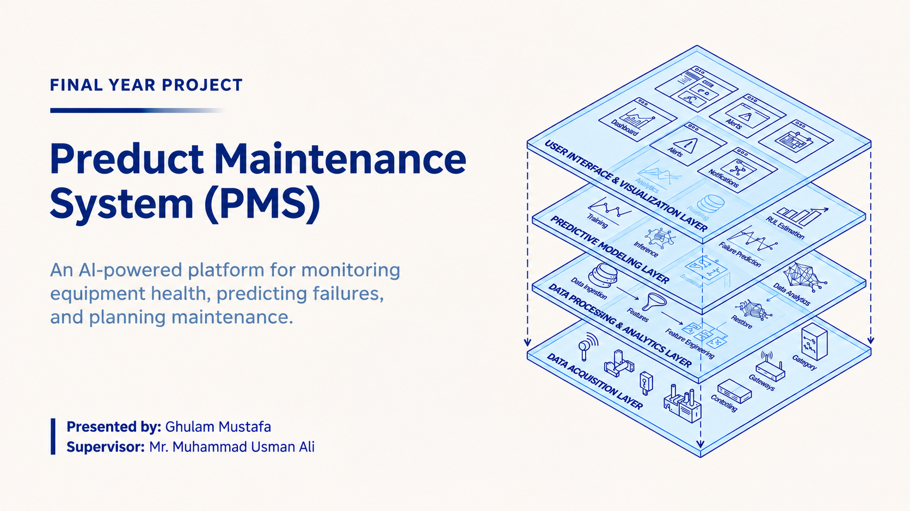
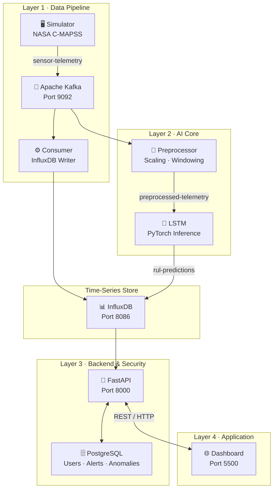
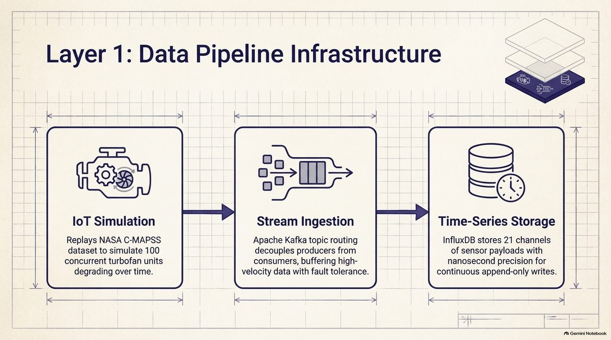
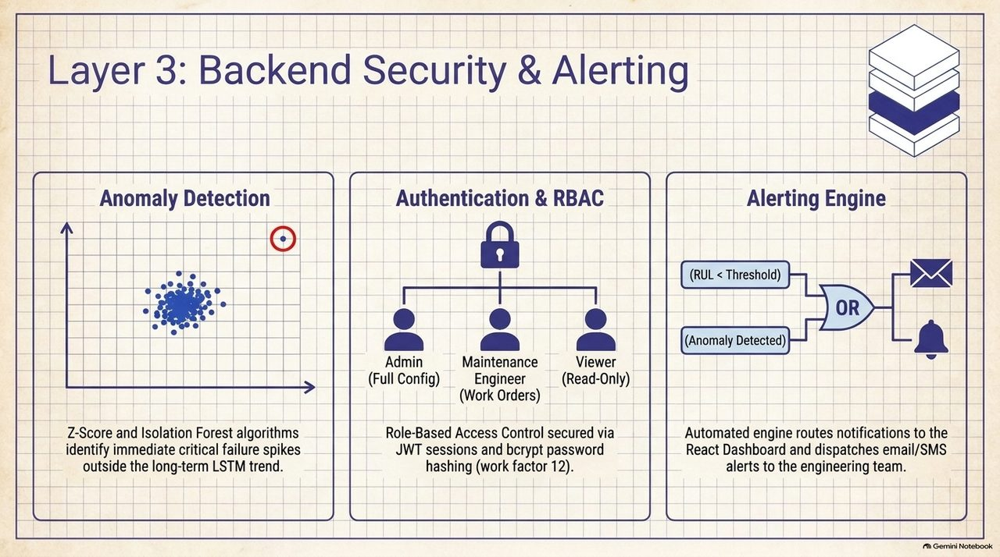
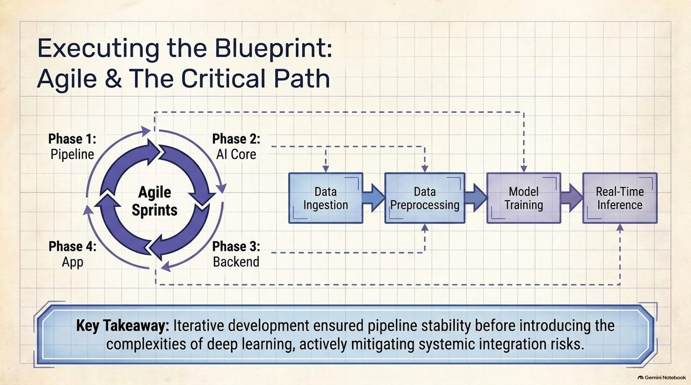
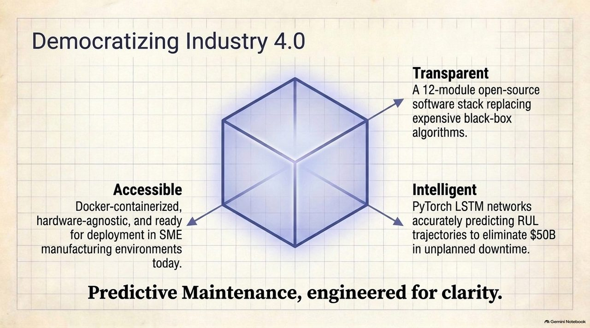

# Predictive Maintenance System

<p align="center">
  
</p>

<p align="center">
  <strong>An AI-powered platform for monitoring equipment health, predicting failures, and planning maintenance.</strong><br>
  Built on the NASA C-MAPSS turbofan engine dataset · Kafka · InfluxDB · PyTorch LSTM · FastAPI · Docker
</p>

---

## Overview

Industrial equipment degrades over time. This system monitors 100 simulated turbofan engines continuously and predicts how many operational cycles remain before each engine is likely to fail — the **Remaining Useful Life (RUL)**. When an engine approaches its end of life, the system raises alerts so maintenance can be scheduled before failure occurs.

The pipeline runs entirely in Docker. A simulator replays real NASA sensor recordings into Kafka, a consumer writes them to InfluxDB, a preprocessing service normalises the stream, and an LSTM prediction service publishes RUL estimates back to Kafka and InfluxDB. The dashboard reads live from both databases.

> 📽️ **[Watch the system demo video](project-%20Info/Predictive_Maintenance_System_Intro.mp4)** · 📊 **[View the full presentation](docs/Predictive_Maintenance_System.pptx)**

---

## System Architecture

The platform is built in four layers, each containerised independently:



> See [`docs/ARCHITECTURE.md`](docs/ARCHITECTURE.md) for a full component breakdown, Kafka topic map, and design decisions.

---

## Presentation

The slides below summarise the full system design. Download the [full PowerPoint](docs/Predictive_Maintenance_System.pptx) for presenter notes.

| | |
|---|---|
|  |  |
| **Title** — Project overview and four-layer architecture | **Problem** — The $50B cost of reactive and preventative maintenance vs. the predictive solution |
|  |  |
| **Differentiation** — PMS vs. commercial black-box systems (IBM Maximo, C3.ai) | **12-Module Architecture** — Four layers from data acquisition to the application UI |
|  |  |
| **Layer 1** — IoT simulation, Apache Kafka stream ingestion, InfluxDB time-series storage | **Layer 2** — Min-Max normalisation, EWMA noise reduction, feature engineering, PyTorch LSTM inference |
|  |  |
| **LSTM Mechanics** — 30-cycle sliding window, RUL curve, 30-cycle safety threshold, RMSE/MAE validation | **Layer 3** — Z-score anomaly detection, JWT + bcrypt RBAC, automated alerting engine |
|  |  |
| **Layer 4** — Live telemetry dashboard, RUL health gauges, maintenance scheduling | **Alert Lifecycle** — Trigger → Alert → Acknowledge → Work Order → Resolution |
|  |  |
| **End-to-End Schematic** — Full pipeline with NFR-01 (< 2 s latency) and NFR-02 (100 concurrent engines) | **Agile Execution** — Four-phase critical path: Pipeline → AI Core → Backend → Application |
|  |  |
| **Risk Management** — ML overfitting, streaming data loss, and deployment inconsistency mitigations | **Future State** — Replacing Python simulator with real MQTT IoT sensors with zero backend changes |
|  | |
| **Conclusion** — Transparent, accessible, and intelligent · *Predictive Maintenance, engineered for clarity* | |

---

## Repository Structure

```
predictive-maintenance-system/
│
├── backend/                  # FastAPI application
│   ├── app/
│   │   ├── routers/          # auth · fleet · alerts · anomalies · rul
│   │   ├── models.py         # SQLAlchemy ORM models
│   │   ├── schemas.py        # Pydantic request/response schemas
│   │   ├── security.py       # JWT, bcrypt, token utilities
│   │   ├── rbac.py           # Role-based access control
│   │   └── anomaly_detector.py
│   ├── main.py
│   ├── Dockerfile
│   └── requirements.txt
│
├── frontend/
│   ├── authentication/       # Login · Register · Password reset · Google OAuth
│   └── dashboard/            # Live operations · Alerts · Anomalies · Users
│
├── ml/
│   ├── prediction/           # LSTM inference service (Kafka consumer + REST)
│   ├── streaming/            # Real-time preprocessing service
│   ├── models/               # Model definitions (LSTM, baselines, training)
│   └── saved_v2_a1/scalers/  # Per-dataset scaler artefacts (FD001–FD004)
│
├── simulator/                # Replays NASA C-MAPSS dataset into Kafka
├── ingestion/                # Kafka → InfluxDB consumer
├── tests/                    # Integration and unit tests
├── docs/                     # Architecture, API reference, slides
└── docker-compose.yml        # Full 9-service stack definition
```

---

## Technology Stack

| Layer | Technology |
|---|---|
| Data source | NASA C-MAPSS turbofan dataset (FD001–FD004) |
| Message broker | Apache Kafka 3.4 + Zookeeper |
| Time-series store | InfluxDB 2.7 (Flux query language) |
| Relational store | PostgreSQL 16 |
| ML framework | PyTorch 2.x — stacked LSTM sequence model |
| Backend API | FastAPI (Python 3.11), SQLAlchemy 2.0 |
| Authentication | JWT (HS256), bcrypt (cost 12), Google OAuth 2.0 |
| Frontend | Vanilla JavaScript, Chart.js, CSS3 |
| Containerisation | Docker, Docker Compose (9 services) |

---

## Key Features

**Data pipeline**
- Simulator streams all four C-MAPSS sub-datasets at configurable speed (default ~100 rows/s)
- Preprocessing service applies Min-Max normalisation + EWMA noise reduction without data leakage — scaler parameters are fixed at training time
- LSTM model runs inference on 30-cycle sliding windows and publishes RUL estimates back through the pipeline

**Dashboard**
- Live fleet view — all 100 engines with health status, latest cycle, and data freshness
- Per-engine sensor telemetry chart across 21 channels
- RUL trend history per run with safety threshold indicator
- Z-score and threshold-based anomaly detection across all sensor channels
- Alert centre with open → acknowledged → resolved lifecycle and full audit trail

**Authentication & access control**
- Email/password registration with verification flow
- Google OAuth with automatic account linking
- Four roles: Admin, Maintenance Engineer, Floor Operator, Viewer
- JWT access tokens (30 min) + refresh tokens (7 days) with JTI revocation blacklist
- Immutable audit log on every auth event and alert state change

**Non-functional requirements met**
- NFR-01 (Latency): < 2 seconds from sensor publish to dashboard update
- NFR-02 (Scalability): 100 concurrent engine units processed without lag
- NFR-03 (Portability): identical execution on Ubuntu, macOS, and Windows via Docker

---

## Documentation

| Document | Description |
|---|---|
| [`docs/ARCHITECTURE.md`](docs/ARCHITECTURE.md) | Component breakdown, data flow, Kafka topic map, design decisions |
| [`docs/API.md`](docs/API.md) | Full REST API reference with request/response shapes |
| [`docs/Predictive_Maintenance_System.pptx`](docs/Predictive_Maintenance_System.pptx) | Full presentation with presenter notes |

---

## Dataset

This project uses the [NASA C-MAPSS Turbofan Engine Degradation Simulation dataset](https://data.nasa.gov/dataset/C-MAPSS-Aircraft-Engine-Simulator-Data/xaut-bemq). The dataset is not included in this repository. Place the raw files under `simulator/data/cmapss/` before starting the simulator.

---

## Project Status

Active development — Final Year Project, University of Engineering and Technology.  
**Supervisor:** Mr. Muhammad Usman Ali &nbsp;|&nbsp; **Author:** Ghulam Mustafa

**Completed**
- Kafka ingestion pipeline and InfluxDB time-series storage (Layer 1)
- Real-time preprocessing with feature scaling and windowing (Layer 2)
- LSTM model training and streaming inference (Layer 2)
- FastAPI backend with JWT auth, RBAC, and audit logging (Layer 3)
- Live dashboard, alert centre, anomaly detection UI, and user management (Layer 4)

**In progress**
- Automated alert triggering directly from the prediction pipeline
- Advanced analytics and reporting page
