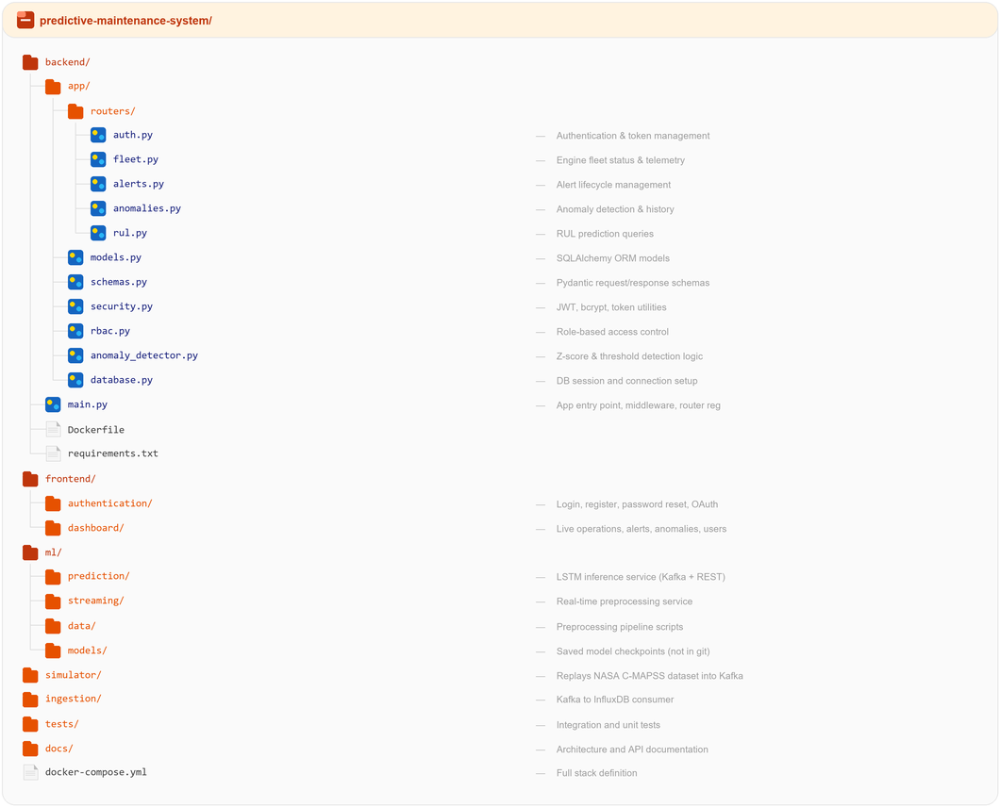
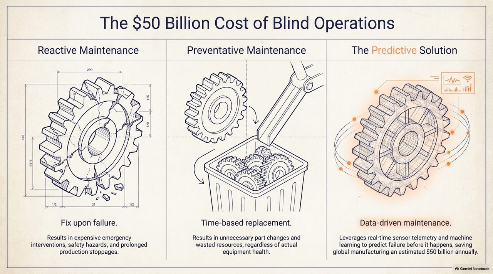
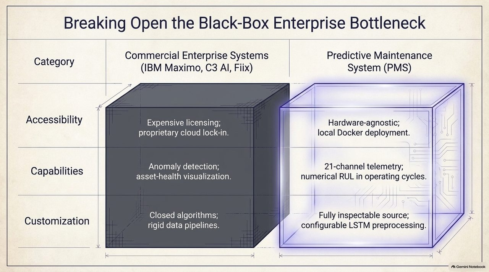
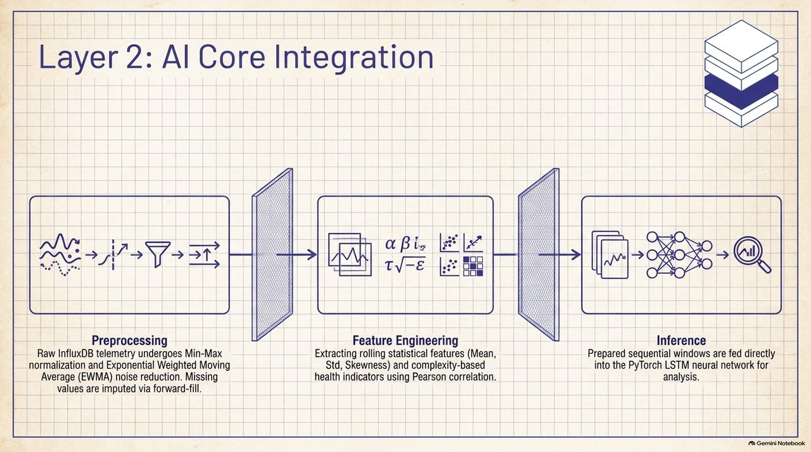
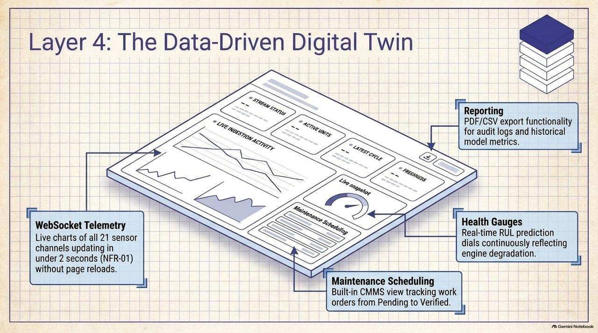
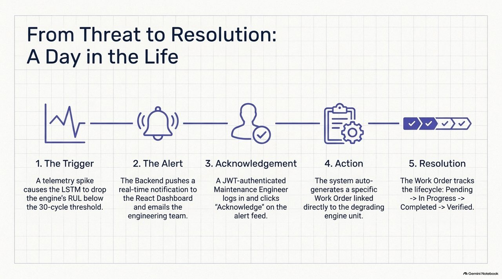
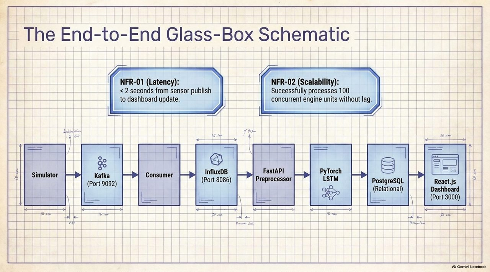
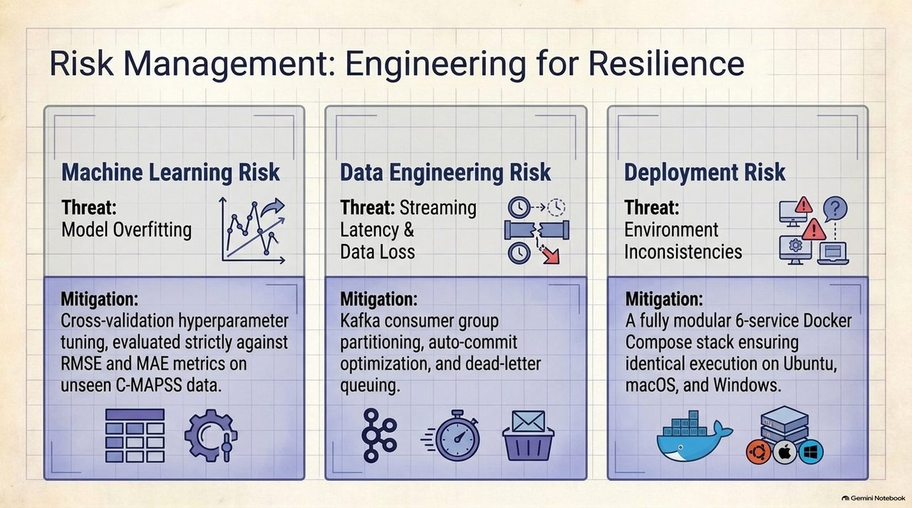

# Predictive Maintenance System (PMS)

Industrial equipment fails without warning - costing manufacturers billions every year in emergency repairs and unplanned downtime. This project builds a complete, end-to-end predictive maintenance platform that continuously monitors 100 simulated turbofan engines, learns from their sensor data, and predicts how many cycles remain before each engine needs servicing.

The system is fully open-source, runs locally with a single Docker command, and is designed so that swapping the simulated data source for real IoT sensors requires zero changes to any other part of the stack.

  <a href="https://youtu.be/4_dOkwqwShI">&#9654; Watch the demo video</a>
  &nbsp;&nbsp;|&nbsp;&nbsp;
  <a href="https://docs.google.com/presentation/d/1jacaOMDywyE-yN3MrrPFCvO5YsLUJAMa/edit?usp=sharing&ouid=114949035556935492523&rtpof=true&sd=true">&#128202; View the presentation</a>

---

## The Problem

Traditional maintenance is either **reactive** (fix it after it breaks — expensive and dangerous) or **preventative** (replace parts on a schedule — wastes resources on healthy equipment). Neither approach uses the actual condition of the machine.

**Predictive maintenance** solves this by reading real sensor data continuously and calculating a **Remaining Useful Life (RUL)** — a concrete number of operational cycles left before the engine is likely to fail. Maintenance is then scheduled exactly when it is needed, not before and not after.

---

## How It Works

The system is built as a streaming data pipeline with four layers:

**Layer 1: Data Pipeline**
A Python simulator replays the NASA C-MAPSS turbofan dataset into Apache Kafka at ~100 messages per second. A separate consumer reads from Kafka and writes every raw sensor reading into InfluxDB, a time-series database optimised for high-frequency append-only writes.

**Layer 2: AI Core**
A preprocessing service reads the same Kafka stream, applies Min-Max normalisation and EWMA noise reduction (using scalers fitted on training data, never on live data), and assembles 30-cycle sliding windows. These windows are fed into a stacked PyTorch LSTM model, which outputs an RUL prediction for each engine. Predictions are written back to InfluxDB.

**Layer 3: Backend and Security**
A FastAPI application serves both the telemetry query layer (reading from InfluxDB) and the application layer (users, alerts, anomaly records stored in PostgreSQL). Every endpoint is protected by JWT authentication with four roles: Admin, Maintenance Engineer, Floor Operator, and Viewer. All state changes are written to an immutable audit log.

**Layer 4: Dashboard**
A browser-based dashboard polls the backend every 5 seconds and shows the live status of all 100 engines, per-engine sensor charts, RUL trend history, an anomaly detection view, and an alert centre where engineers can acknowledge and resolve issues.

---

## System Architecture

  

> Full component breakdown and design decisions: [docs/ARCHITECTURE.md](docs/ARCHITECTURE.md)

---

## Repository Structure

  

---

## Technology Stack

| Layer | Technology | Why |
|---|---|---|
| Data source | NASA C-MAPSS dataset (FD001-FD004) | Publicly available benchmark for turbofan degradation |
| Message broker | Apache Kafka 3.4 + Zookeeper | Decouples producers from consumers; buffers backpressure |
| Time-series store | InfluxDB 2.7 | Optimised for high-frequency sensor writes and range queries |
| Relational store | PostgreSQL 16 | Structured application data: users, alerts, audit logs |
| ML framework | PyTorch 2.x — stacked LSTM | Sequence model well-suited to multi-variate time-series degradation |
| Backend API | FastAPI (Python 3.11), SQLAlchemy 2.0 | Async-ready, auto-documented REST API |
| Authentication | JWT + bcrypt (cost 12) + Google OAuth 2.0 | Stateless tokens with secure password hashing |
| Frontend | Vanilla JavaScript, Chart.js, CSS3 | No build toolchain; straightforward to read and modify |
| Containerisation | Docker, Docker Compose (9 services) | One command to run the full stack on any OS |

---

## Key Features

**Real-time data pipeline**
- Kafka topics decouple simulation, preprocessing, prediction, and storage — each service can be restarted independently
- Preprocessing scalers are fixed at training time, preventing any data leakage from live readings into the model
- Dead-letter topic captures any unprocessable messages for inspection without data loss

**Machine learning**
- 30-cycle sliding window input feeds a two-layer LSTM trained on all four C-MAPSS sub-datasets
- Piece-wise linear RUL targets — flat region for healthy engines, linear decrease as degradation begins — matches real degradation behaviour
- Validated against NASA test sets using RMSE and MAE

**Live dashboard**
- Fleet overview: 100 engines ranked by health status (healthy / warning / offline)
- Per-engine telemetry chart: select any of 21 sensor channels across any time range
- RUL panel: latest prediction, cycle, run ID, model version, and freshness
- Anomaly detection: Z-score and threshold methods run on demand against stored telemetry
- Alert centre: open / acknowledged / resolved lifecycle with full audit trail per alert

**Security and access control**
- Four roles with strict endpoint guards: Admin, Maintenance Engineer, Floor Operator, Viewer
- JWT access tokens expire in 30 minutes; refresh tokens in 7 days; revoked JTIs are blacklisted on logout
- Google OAuth with automatic account linking if the email already exists
- Every login, logout, role change, and alert state change is recorded in a tamper-evident audit log

---

## Presentation

The slides below summarise the full system. Open the [full presentation](https://docs.google.com/presentation/d/1jacaOMDywyE-yN3MrrPFCvO5YsLUJAMa/edit?usp=sharing&ouid=114949035556935492523&rtpof=true&sd=true) for presenter notes.

| | |
|---|---|
|  |  |
| **Title** — Project overview and four-layer architecture | **Problem** — The $50B cost of reactive and preventative maintenance vs. the predictive solution |
|  |  |
| **Differentiation** — PMS vs. commercial black-box systems (IBM Maximo, C3.ai) | **12-Module Architecture** — Four layers from data acquisition to the application UI |
|  |  |
| **Layer 1** — IoT simulation, Kafka ingestion, InfluxDB time-series storage | **Layer 2** — Normalisation, noise reduction, feature engineering, LSTM inference |
|  |  |
| **LSTM Mechanics** — 30-cycle window, RUL curve, 30-cycle safety threshold | **Layer 3** — Anomaly detection, JWT + RBAC, alerting engine |
|  |  |
| **Layer 4** — Live dashboard, RUL gauges, maintenance scheduling | **Alert lifecycle** — Trigger to alert to acknowledge to work order to resolution |
|  |  |
| **End-to-end schematic** — NFR-01 (< 2 s latency), NFR-02 (100 concurrent engines) | **Agile execution** — Four-phase critical path |
|  |  |
| **Risk management** — Overfitting, data loss, deployment inconsistency | **Future state** — Replace simulator with real MQTT IoT sensors, zero backend changes |
|  | |
| **Conclusion** — Transparent, accessible, intelligent. Predictive Maintenance, engineered for clarity. | |

---

## Documentation

| Document | What it covers |
|---|---|
| [docs/ARCHITECTURE.md](docs/ARCHITECTURE.md) | Each service, Kafka topic map, InfluxDB measurements, design decisions |
| [docs/API.md](docs/API.md) | Every REST endpoint with request bodies, response shapes, and required roles |

---

## Module Documentation

| # | Module | Description | Documentation | Status |
|---|---|---|---|---|
| 01 | **IoT Simulation** | NASA C-MAPSS and IMS dataset simulation, MQTT publishing, Kafka integration and telemetry event management | [Notion guide](https://app.notion.com/p/ghulammustafa/Module-01-IoT-Simulation-41a6c3c1abf18095839fe060beb29214) · [Baseline](docs/MODULE1_BASELINE.md) · [Architecture](docs/MODULE1_ARCHITECTURE.md) · [Verification report](docs/MODULE1_FINAL_VERIFICATION_REPORT.md) | ✅ Verified core baseline |
| 02 | Kafka Ingestion & MQTT Bridge | Raw telemetry consumer writing to InfluxDB; MQTT-to-Kafka bridge routing C-MAPSS and IMS events | [Architecture](docs/ARCHITECTURE.md) | ✅ Completed |
| 03 | InfluxDB Storage | Time-series storage for raw sensor readings with tag-based queries | [Architecture](docs/ARCHITECTURE.md) | ✅ Completed |
| 04 | Data Preprocessing | Min-Max normalisation, sliding window assembly, RUL label assignment | [Architecture](docs/ARCHITECTURE.md) | ✅ Completed |
| 05 | Feature Engineering | Sensor selection, EWMA smoothing, feature store | [Architecture](docs/ARCHITECTURE.md) | ✅ Completed |
| 06 | LSTM RUL Prediction | Two-layer stacked LSTM inference service; writes predictions to InfluxDB | [Architecture](docs/ARCHITECTURE.md) | ✅ Completed |
| 07 | Anomaly Detection | Z-score and threshold-based anomaly detection on stored telemetry | [Architecture](docs/ARCHITECTURE.md) | ✅ Completed |
| 08 | Backend API & Auth | FastAPI service: JWT + RBAC, alert lifecycle, audit log, PostgreSQL | [API reference](docs/API.md) | ✅ Completed |
| 09 | Alert Engine | Alert creation, acknowledgement, resolution and work-order lifecycle | [API reference](docs/API.md) | ✅ Completed |
| 10 | Frontend Dashboard | Fleet status, sensor charts, RUL panel, anomaly page, alert centre | — | ✅ Completed |
| 11 | User Management | Admin CRUD for users, roles and permissions | [API reference](docs/API.md) | ✅ Completed |
| 12 | Reporting & Analytics | Advanced analytics and reporting page | — | 🔄 In progress |

---

## Technical Reference

---

## Technical Reference

| Document | What it covers |
|---|---|
| [docs/MODULE1_BASELINE.md](docs/MODULE1_BASELINE.md) | Module 01 verified baseline, public interfaces, event schemas, change-control policy |
| [docs/MODULE1_ARCHITECTURE.md](docs/MODULE1_ARCHITECTURE.md) | Module 01 component design, data-flow diagrams, replay modes |
| [docs/MODULE1_FINAL_VERIFICATION_REPORT.md](docs/MODULE1_FINAL_VERIFICATION_REPORT.md) | Complete Module 01 verification evidence with test results |
| [docs/ENVIRONMENT_VARIABLES.md](docs/ENVIRONMENT_VARIABLES.md) | All environment variables for Modules 01 and 02 |

---

## Dataset

This project uses the [NASA C-MAPSS Turbofan Engine Degradation Simulation dataset](https://data.nasa.gov/dataset/C-MAPSS-Aircraft-Engine-Simulator-Data/xaut-bemq).
The dataset files are not included in this repository. Download them from NASA and place them under `simulator/data/cmapss/` before starting the simulator service.

---

## Project Status

**Completed**

- Layer 1: Kafka ingestion pipeline and InfluxDB time-series storage
- Layer 2: Real-time preprocessing, LSTM model training and streaming inference
- Layer 3: FastAPI backend with JWT authentication, RBAC, anomaly detection, and alert lifecycle
- Layer 4: Live dashboard, fleet view, alert centre, anomaly page, and user management

**In progress**

- Automated alert triggering from the prediction pipeline
- Advanced analytics and reporting page

---

## Project Status

**Active development** 
Author: Ghulam Mustafa 
Supervisor: Dr. Muhammad Imran 
University: SZABIST University, Islamabad Campus.
