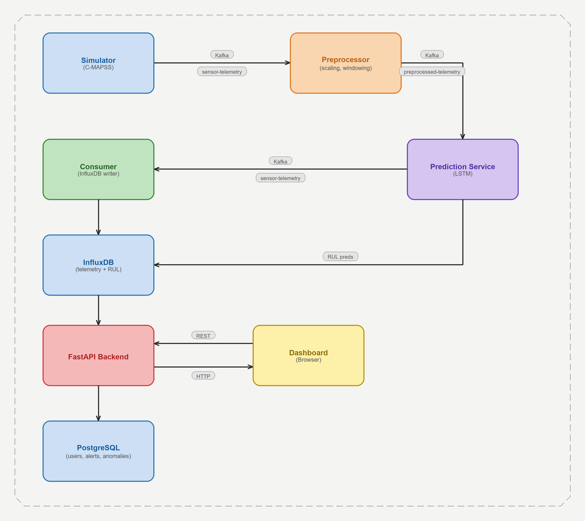
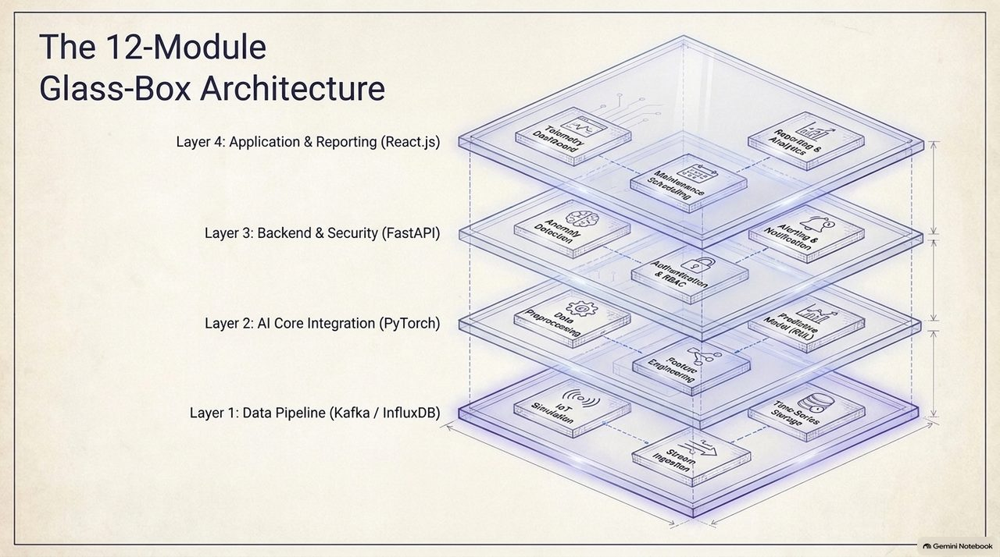
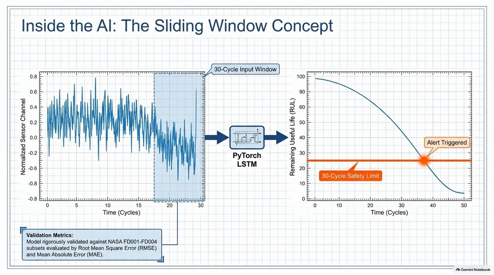
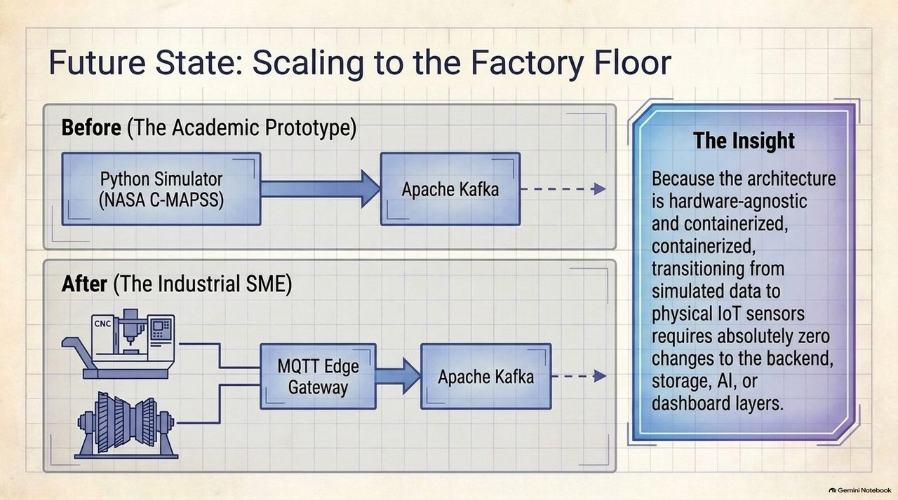

# Predictive Maintenance System

**A real-time predictive maintenance platform built on the NASA C-MAPSS turbofan engine dataset.**

Streams sensor telemetry through Apache Kafka, stores it in InfluxDB, runs a PyTorch LSTM model to predict Remaining Useful Life (RUL), and surfaces everything through a live web dashboard with authentication and role-based access control.

<a href="https://youtu.be/4_dOkwqwShI">&#9654; Watch the demo video</a>
&nbsp;&nbsp;|&nbsp;&nbsp;
<a href="https://docs.google.com/presentation/d/1jacaOMDywyE-yN3MrrPFCvO5YsLUJAMa/edit?usp=sharing&ouid=114949035556935492523&rtpof=true&sd=true">&#128202; Download the presentation</a>

---

## What it does

A real-time predictive maintenance platform built on the NASA C-MAPSS turbofan engine dataset. The system streams sensor telemetry through Apache Kafka, stores it in InfluxDB, runs an LSTM model to predict Remaining Useful Life (RUL), and surfaces everything through a live web dashboard with authentication and role-based access control.

Industrial equipment degrades over time. This system monitors 100 simulated turbofan engines continuously and predicts how many operational cycles remain before each engine is likely to fail. When an engine approaches its end of life, the system raises alerts so maintenance can be scheduled before failure occurs.

The pipeline runs entirely in Docker and processes data end-to-end: a simulator replays real NASA sensor recordings into Kafka, a consumer writes them to InfluxDB, a preprocessing service normalises the stream, and an LSTM prediction service publishes RUL estimates back to Kafka and InfluxDB. The dashboard reads from InfluxDB and PostgreSQL in real time.

---

## System Architecture

  

> See [docs/ARCHITECTURE.md](docs/ARCHITECTURE.md) for a full component breakdown, Kafka topic map, and design decisions.

---

## Repository Structure

  

---

## Technology Stack

| Layer | Technology |
|---|---|
| Data source | NASA C-MAPSS turbofan dataset (FD001-FD004) |
| Message broker | Apache Kafka 3.4 + Zookeeper |
| Time-series store | InfluxDB 2.7 (Flux query language) |
| Relational store | PostgreSQL 16 |
| ML framework | PyTorch 2.x - stacked LSTM sequence model |
| Backend API | FastAPI (Python 3.11), SQLAlchemy 2.0 |
| Authentication | JWT (HS256), bcrypt (cost 12), Google OAuth 2.0 |
| Frontend | Vanilla JavaScript, Chart.js, CSS3 |
| Containerisation | Docker, Docker Compose (9 services) |

---

## Key Features

**Data pipeline**
- Simulator streams all four C-MAPSS sub-datasets (FD001-FD004) at configurable speed (~100 rows/s)
- Preprocessing applies Min-Max normalisation + EWMA noise reduction without data leakage
- LSTM model runs inference on 30-cycle sliding windows and publishes RUL estimates back through the pipeline

**Dashboard**
- Live fleet view - all 100 engines with health status, latest cycle, and data freshness
- Per-engine sensor telemetry chart across 21 channels
- RUL trend history per run with safety threshold indicator
- Z-score and threshold-based anomaly detection across all sensor channels
- Alert centre with open to acknowledged to resolved lifecycle and full audit trail

**Authentication and access control**
- Email/password registration with verification flow
- Google OAuth with automatic account linking
- Four roles: Admin, Maintenance Engineer, Floor Operator, Viewer
- JWT access tokens (30 min) + refresh tokens (7 days) with JTI revocation blacklist
- Immutable audit log on every auth event and alert state change

---

## Presentation

The slides below summarise the full system design. Open the [full presentation](https://docs.google.com/presentation/d/1jacaOMDywyE-yN3MrrPFCvO5YsLUJAMa/edit?usp=sharing&ouid=114949035556935492523&rtpof=true&sd=true) to view with presenter notes.

| | |
|---|---|
|  |  |
| **Title** - Project overview and four-layer architecture | **Problem** - The $50B cost of reactive and preventative maintenance vs. the predictive solution |
|  |  |
| **Differentiation** - PMS vs. commercial black-box systems (IBM Maximo, C3.ai) | **12-Module Architecture** - Four layers from data acquisition to the application UI |
|  |  |
| **Layer 1** - IoT simulation, Apache Kafka stream ingestion, InfluxDB time-series storage | **Layer 2** - Min-Max normalisation, EWMA noise reduction, feature engineering, PyTorch LSTM inference |
|  |  |
| **LSTM Mechanics** - 30-cycle sliding window, RUL curve, 30-cycle safety threshold, RMSE/MAE validation | **Layer 3** - Z-score anomaly detection, JWT + bcrypt RBAC, automated alerting engine |
|  |  |
| **Layer 4** - Live telemetry dashboard, RUL health gauges, maintenance scheduling | **Alert Lifecycle** - Trigger to Alert to Acknowledge to Work Order to Resolution |
|  |  |
| **End-to-End Schematic** - Full pipeline with NFR-01 (< 2s latency) and NFR-02 (100 concurrent engines) | **Agile Execution** - Four-phase critical path: Pipeline to AI Core to Backend to Application |
|  |  |
| **Risk Management** - ML overfitting, streaming data loss, and deployment inconsistency mitigations | **Future State** - Replacing Python simulator with real MQTT IoT sensors with zero backend changes |
|  | |
| **Conclusion** - Transparent, accessible, and intelligent. Predictive Maintenance, engineered for clarity. | |

---

## Documentation

| Document | Description |
|---|---|
| [docs/ARCHITECTURE.md](docs/ARCHITECTURE.md) | Component breakdown, data flow, Kafka topic map, design decisions |
| [docs/API.md](docs/API.md) | Full REST API reference with request/response shapes |

---

## Dataset

This project uses the [NASA C-MAPSS Turbofan Engine Degradation Simulation dataset](https://data.nasa.gov/dataset/C-MAPSS-Aircraft-Engine-Simulator-Data/xaut-bemq). The dataset is not included in this repository. Place the raw files under simulator/data/cmapss/ before starting the simulator.

---

## Project Status

Active development - Final Year Project, SZABIST University, Islamabad Campus.
Supervisor: Dr. Muhammad Imran | Author: Ghulam Mustafa

**Completed**
- Kafka ingestion pipeline and InfluxDB time-series storage (Layer 1)
- Real-time preprocessing with feature scaling and windowing (Layer 2)
- LSTM model training and streaming inference (Layer 2)
- FastAPI backend with JWT auth, RBAC, and audit logging (Layer 3)
- Live dashboard, alert centre, anomaly detection UI, and user management (Layer 4)

**In progress**
- Automated alert triggering directly from the prediction pipeline
- Advanced analytics and reporting page