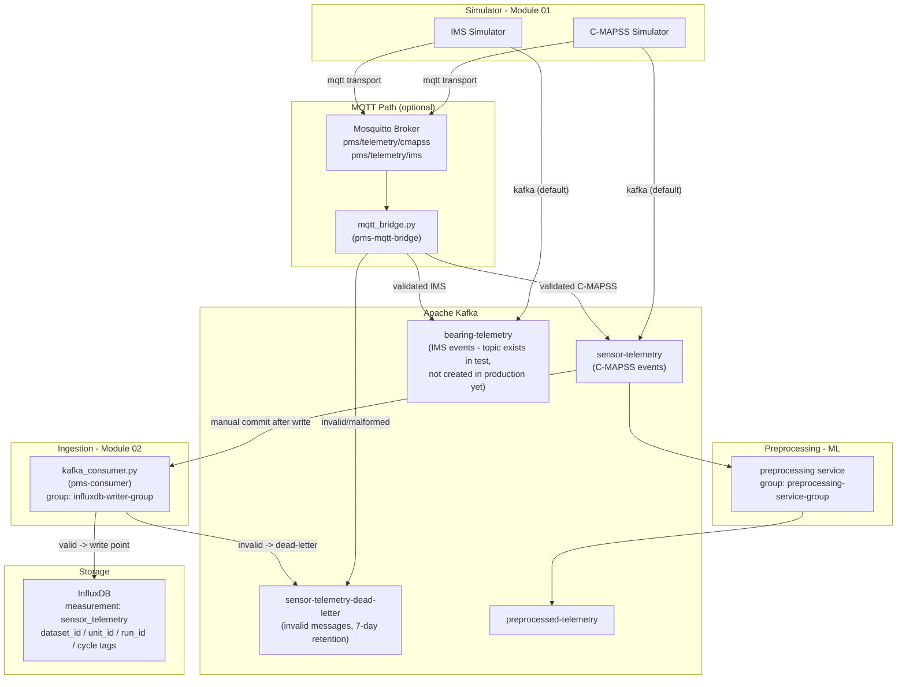

# Module 02 — Data Ingestion: Architecture

> The bridge uses Paho 2 manual acknowledgment and a stable persistent MQTT session. Kafka confirmation precedes acknowledgment; publish failures stop the bridge without acknowledging. Isolated outage, broker restart and active-ingestion restart checks passed; they do not establish recovery for every failure mode. Use a unique stable `MQTT_CLIENT_ID` per bridge instance. QoS 0 has no acknowledgment or redelivery guarantee. See the verification report.

Versioned C-MAPSS messages require identity and sequence fields, a supported source type and an asset ID matching the unit. Legacy messages without `schema_version` retain the earlier optional identity defaults. Null sensor values are omitted, while non-finite values are rejected. Identical measurement, tag and timestamp combinations overwrite an InfluxDB point; `event_id` is not stored or used for deduplication. The consumer commits after a synchronous write or confirmed dead-letter publication, and write failures leave the offset uncommitted.

**Version:** 1.0  
**Date:** 2026-11-19  
**Git HEAD:** `b41ef9b` (baseline) + Module 02 tests and docs  
**Status:** Verified — 12/12 isolated E2E checks PASS

---

## 1. Overview

Module 02 is the data ingestion layer of the Predictive Maintenance System.  
It consumes raw sensor telemetry from Apache Kafka and writes it durably
to InfluxDB time-series storage, where downstream services (prediction API,
dashboard) can query it.

It has two components:

| Component | File | Purpose |
|---|---|---|
| **Kafka Consumer** | `ingestion/src/kafka_consumer.py` | Read `sensor-telemetry`, validate, write to InfluxDB |
| **MQTT Bridge** | `ingestion/src/mqtt_bridge.py` | Forward MQTT telemetry into the correct Kafka topics |

Both run from the same Docker image (`ingestion/Dockerfile`).

---

## 2. Architecture Diagram



---

## 3. Data Flow

### 3.1 C-MAPSS Turbofan Path (primary)

```
Simulator (cmapss_loader.py)
  │  PUBLISH_TRANSPORT=kafka (default)
  │  Kafka key: {dataset_id}:{unit_id}:{run_id}
  ▼
Kafka: sensor-telemetry  (partition 0)
  │
  ├──▶ kafka_consumer.py (pms-consumer)
  │       decode_message()      ← validate required fields + types
  │       build_point()         ← construct InfluxDB point
  │       write_to_influxdb()   ← SYNCHRONOUS write, 3 retries
  │       commit_message()      ← commit offset ONLY after successful write
  │       ▼
  │    InfluxDB: sensor_telemetry measurement
  │
  └──▶ preprocessing service (pms-preprocessing) [independent consumer]
          ▶ preprocessed-telemetry
```

### 3.2 MQTT Path

```
Simulator (mqtt_publisher.py)
  │  PUBLISH_TRANSPORT=mqtt
  │  QoS 1
  ▼
Mosquitto: pms/telemetry/cmapss   or   pms/telemetry/ims
  ▼
mqtt_bridge.py (pms-mqtt-bridge)
  │  validate_cmapss() / validate_ims()
  │  Kafka key: {dataset_id}:{unit_id}:{run_id}
  ▼
Kafka: sensor-telemetry  or  bearing-telemetry
  ▼
(same as direct Kafka path above)
```

### 3.3 Invalid Message Path

```
Any message that fails validation
  ▼
Kafka: sensor-telemetry-dead-letter
  (retention: 7 days, broker-confirmed write before commit)
```

---

## 4. InfluxDB Storage Schema

**Measurement:** `sensor_telemetry`

### Tags (indexed, used for filtering)

| Tag | Example value | Notes |
|---|---|---|
| `dataset_id` | `FD001` | C-MAPSS sub-dataset |
| `unit_id` | `1` | Engine identifier (string) |
| `run_id` | `abc123def456...` | Replay pass identifier (hex UUID) |
| `cycle` | `42` | Time cycle (string — for cardinality) |

### Fields (measured values)

| Field | Type | Notes |
|---|---|---|
| `time_cycles` | int | Cycle number |
| `operational_setting_1` | float | |
| `operational_setting_2` | float | |
| `operational_setting_3` | float | |
| `sensor_1` … `sensor_21` | float | 21 NASA C-MAPSS sensor readings |

**Timestamp:** ISO-8601 from the `timestamp` field in the event envelope.
If `source_timestamp` is present, it takes precedence.

### Duplicate-Point Behavior

InfluxDB uses **last-write-wins** for a point with identical
`(measurement, tags, timestamp)`. An identical retry retains that point
identity and overwrites it. Two events with the same run, unit and cycle but
different timestamps are different points; `event_id` is not used to deduplicate.

---

## 5. Kafka Reliability Model

| Property | Value |
|---|---|
| Consumer group | `influxdb-writer-group` |
| Auto-offset-commit | `False` (manual commit) |
| Offset committed | After successful InfluxDB write **or** successful DLQ write |
| Delivery guarantee | **At-least-once** — if the consumer crashes after a write but before commit, the message will be re-consumed on restart; InfluxDB's last-write-wins de-duplicates the point |
| Infrastructure failure | Exception propagates; offset is **not** committed; consumer restarts (Compose `restart: on-failure`) and re-processes the message |
| Auth failure (401/403) | Raised immediately without retry; operator attention required |
| Transient failure | 3 attempts with exponential backoff (1s, 2s base) |
| Dead-letter producer | `acks=all`, awaits broker ack before source offset is committed |

**Delivery guarantee: at-least-once.**  
Identical point identities overwrite; this is not general event-ID deduplication.
No exactly-once transaction semantics are claimed.

---

## 6. Source Files

```
ingestion/
  Dockerfile          FROM python:3.11-slim; runs kafka_consumer.py by default
  requirements.txt    kafka-python, influxdb-client, python-dotenv, paho-mqtt
  src/
    kafka_consumer.py   Kafka consumer → InfluxDB writer
    mqtt_bridge.py      MQTT subscriber → Kafka forwarder
```

---

## 7. Environment Variables

### Kafka Consumer (`pms-consumer`)

| Variable | Default | Description |
|---|---|---|
| `KAFKA_BROKER` | `kafka:9092` | Kafka bootstrap server |
| `SENSOR_TOPIC` | `sensor-telemetry` | Topic to consume |
| `CONSUMER_GROUP` | `influxdb-writer-group` | Consumer group ID |
| `DEAD_LETTER_TOPIC` | `sensor-telemetry-dead-letter` | Invalid message destination |
| `INFLUXDB_URL` | `http://influxdb:8086` | InfluxDB endpoint |
| `INFLUXDB_TOKEN` | — | Auth token (required) |
| `INFLUXDB_ORG` | `pms-org` | Organisation |
| `INFLUXDB_BUCKET` | `sensor-data` | Bucket |
| `INFLUX_MAX_WRITE_RETRIES` | `3` | Write retry count |
| `INFLUX_RETRY_BACKOFF_SECONDS` | `1` | Base backoff (doubles each retry) |
| `INFLUX_TIMEOUT_MS` | `10000` | InfluxDB client timeout |
| `KAFKA_POLL_TIMEOUT_MS` | `1000` | Poll timeout per batch |
| `KAFKA_MAX_POLL_RECORDS` | `5` | Records per poll |
| `KAFKA_MAX_POLL_INTERVAL_MS` | `600000` | Max poll interval |
| `KAFKA_COMMIT_TIMEOUT_MS` | `10000` | Commit timeout |

### MQTT Bridge (`pms-mqtt-bridge`)

| Variable | Default | Description |
|---|---|---|
| `KAFKA_BROKER` | `kafka:9092` | Kafka bootstrap server |
| `SENSOR_TOPIC` | `sensor-telemetry` | C-MAPSS destination topic |
| `BEARING_TOPIC` | `bearing-telemetry` | IMS destination topic |
| `DEAD_LETTER_TOPIC` | `sensor-telemetry-dead-letter` | Invalid message destination |
| `MQTT_BROKER` | `mosquitto` | MQTT broker hostname |
| `MQTT_PORT` | `1883` | MQTT broker port |
| `MQTT_TOPIC_CMAPSS` | `pms/telemetry/cmapss` | Subscribed C-MAPSS topic |
| `MQTT_TOPIC_IMS` | `pms/telemetry/ims` | Subscribed IMS topic |
| `MQTT_QOS` | `1` | Subscription QoS |

---

## 8. Known Limitations

| ID | Limitation | Severity |
|---|---|---|
| L-1 | `bearing-telemetry` has no downstream consumer — IMS data is not written to InfluxDB | Medium (planned, Modules 7+) |
| L-2 | `bearing-telemetry` topic does not exist in production Kafka (created by `kafka-topic-init` only on fresh stack startup) | Medium |
| L-3 | No consumer-side `event_id` deduplication — relies on InfluxDB point overwrite | Low |
| L-4 | SequenceTracker is not used by the ingestion consumer — gaps and out-of-order arrivals are not logged | Low |
| L-5 | paho-mqtt 2.x `CallbackAPIVersion` DeprecationWarning (cosmetic) | Info |
| L-6 | Unexpected infrastructure errors cause infinite retry via `restart: on-failure` with no backoff between container restarts | Low |

---

## 9. Connection to Other Modules

| Module | Relationship |
|---|---|
| **Module 01 (Simulator)** | Produces all messages that Module 02 consumes |
| **Module 03+ (Preprocessing / Prediction)** | Consumes `sensor-telemetry` independently (separate consumer group) |
| **Module 05 (Dashboard API)** | Queries InfluxDB `sensor_telemetry` measurement written by Module 02 |
| **Modules 7+ (Bearing Anomaly)** | Will consume `bearing-telemetry`; consumer not yet implemented |
