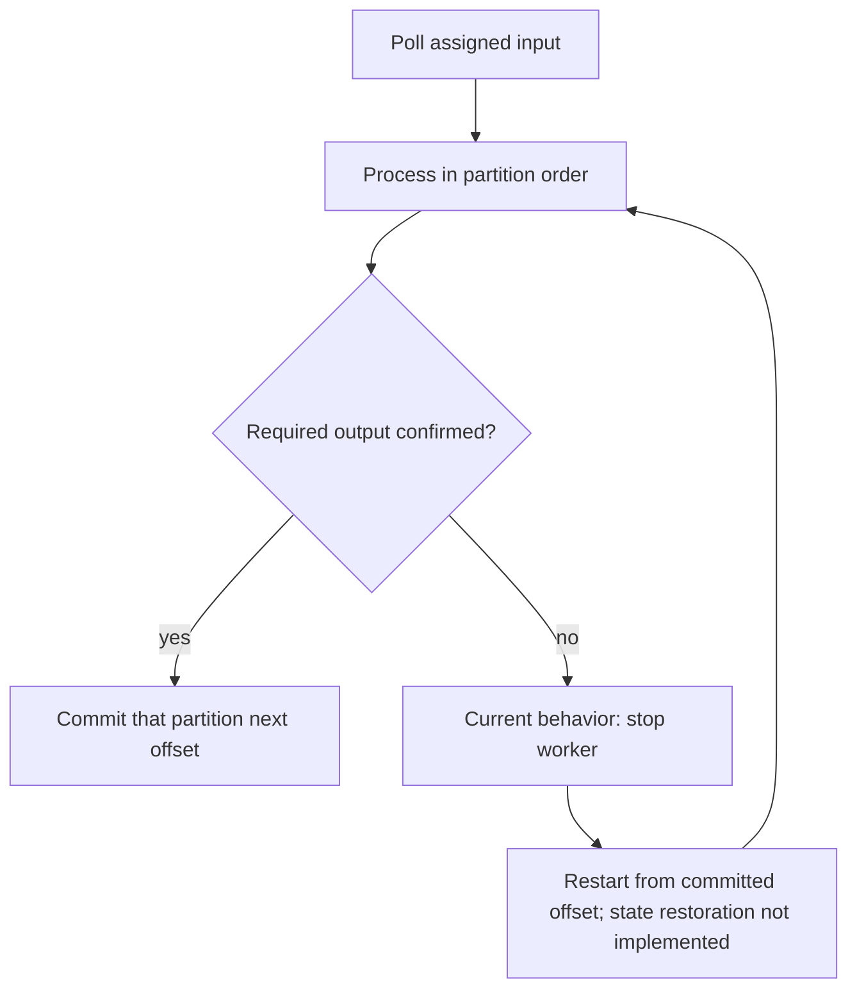
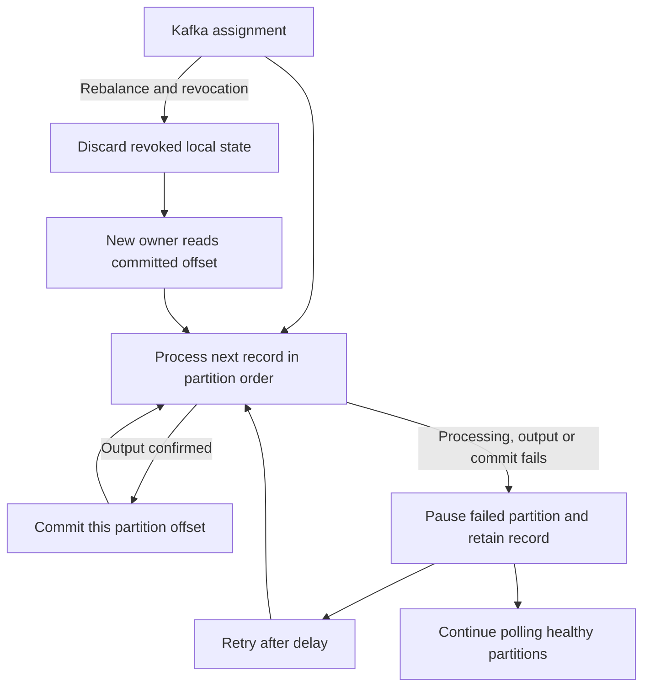
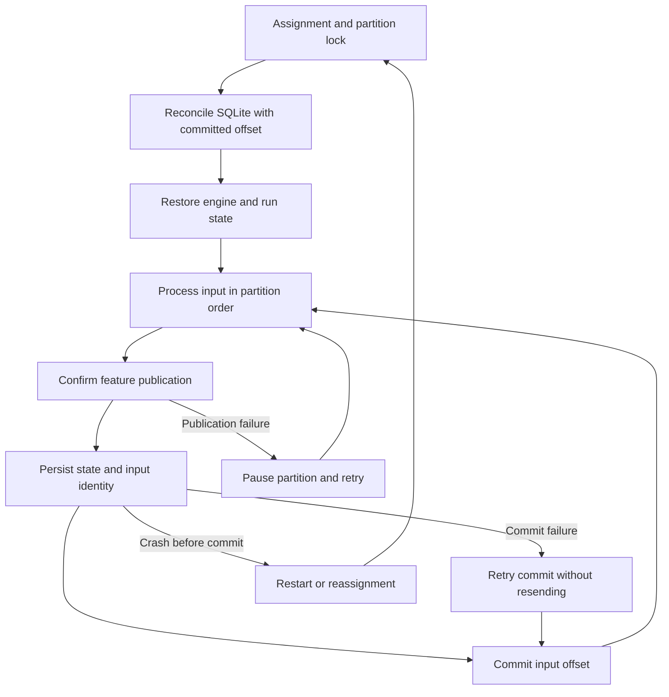

# Pipeline offset safety — work in progress

Preprocessing and prediction previously committed the consumer's general position after each record and continued after output failures. A later commit could cover an earlier failed input. Both now process synchronously, wait for Kafka output confirmation, and commit the handled record's next offset for its own topic and partition. Any processing or commit exception stops that consumer loop and discards its in-memory processing state rather than continuing to later records. Invalid downstream records now stop processing instead of being committed without a durable dead letter.

Ingestion already uses synchronous InfluxDB writes or confirmed dead-letter publication followed by an explicit per-partition offset commit. Neither pipeline has exactly-once semantics: successful output followed by commit failure can be duplicated on replay, and prediction's Kafka and Influx writes are not atomic. A broker timeout can have an unknown outcome. Downstream writes and side effects require reconciliation.

The new fail-stop behavior is intentionally conservative: a failure on one partition stops the entire worker, so other partitions do not progress independently until restart. It prevents an intentionally later commit by that worker, but rebalances, stale in-flight writes, process restarts, state reconstruction and real broker failures have not yet been verified. State is memory-only: restarting from committed offsets does not reconstruct earlier preprocessing fill state or prediction windows. Do not deploy this change as a complete recovery solution until those scenarios are resolved and tested.

Focused mock checks exercised first, middle and last output failure and explicit per-partition commits. They do not establish broker-level guarantees. See `PIPELINE_E2E_VERIFICATION.md` for missing work.

## Subsequent isolated broker evidence

On 20 November, a new Kafka/ZooKeeper pair was started on the internal network `pms-relverify-20261120-b2-net`, with no published ports or production mounts. A probe ran the current preprocessing consumer loop against `relverify-b2-input` with two partitions and group `relverify-b2-5c0c244a04`; the transform was replaced with a test function, while sends and commits used the real isolated broker. Partition 1 offset 1 and partition 0 offset 0 were processed and their next offsets 2 and 1 committed. An injected failure at partition 0 offset 1 stopped the worker. The broker still reported committed positions p0=1, p1=2. A new partition 1 record at offset 2 remained unprocessed; restarting a consumer from the same group returned p0 offset 1 and p1 offset 2. Final group lag was 1 on each partition. This demonstrates no later commit in that single fail-stop scenario and demonstrates the independent-progress requirement is **not met**. The probe did not test actual preprocessing transformations, output timeouts, rebalances, or state restoration.

The current preprocessor stores previous raw values for imputation and a bounded list of scaled rows per dataset/unit/run. The inspected streaming path does not calculate rolling mean or standard deviation from that list; fitted scalers and training statistics are loaded on demand. Its state is not checkpointed. Prediction likewise does not restore its last cycle or window. No durable checkpoint or deterministic replay scheme has yet been implemented or demonstrated, including the cross-worker/partition ownership and duplicate-output handling needed during rebalances.

## Candidate partition-isolation design — not implemented

Use one Kafka consumer thread to own poll, pause/resume, seek and commits, with bounded per-partition pending records and backoff. Process one record per partition in offset order, confirm output before committing that partition's next offset, and pause only the failing partition while continuing polling and heartbeats for healthy assignments. Restore or discard uncommitted state on failure, and stop or fence work on revocation before another owner takes over. A commit failure or an ambiguous delivery is not proof that a write failed; retry can duplicate output. A durable partition-aware checkpoint and output identity are needed before restart/reassignment can preserve state, and prefetched batches must not permit a later record to pass a blocked record. No independent-partition behavior or state recovery has been implemented by this design note.

The diagram describes the current fail-stop behavior and its unresolved recovery limitation. The partition pause and shared checkpoint design above is not implemented.
# Preprocessing partition isolation: isolated verification, 20 November 2026

The preprocessing worker holds one failed record per partition, pauses that partition, retries it in order and polls the other assignments on the same consumer thread. It publishes with broker acknowledgement before committing the input offset. A failed transform, output or commit restores the partition's in-memory state before retry. Revocation clears the local retry and state; the next owner starts from Kafka's committed offset. Each output Kafka key is `input-topic:partition:offset`, so duplicate deliveries for an input can be identified; this is at-least-once, not exactly-once processing. A persistent commit failure causes repeated output writes on retries.

Isolated Kafka tests observed partition 0 at offset 13 of 14 while partition 1 advanced to 11 of 11 during an injected output failure. After clearing it, partition 0 reached 15 of 15, including a subsequent record. An injected commit failure left partition 0 at 15 of 16; after recovery it advanced. The output topic contained 16 records with key `preproc-isolation-input:0:15`, showing duplicates from repeated retries. A failed partition was reassigned to another isolated group member and advanced from 16 of 17 to 17 of 17 after the fault cleared. The test did not independently demonstrate a stale commit attempt fenced after revocation. These are client-side injected failures against a real broker, not broker outage tests.

`kafka-python` 3.0.12 repeatedly stalled after successful retry in this setup; version 3.0.13 passed the above continuation and reassignment observations and is pinned for the preprocessing image. This comparison does not establish the underlying client defect. A first uncommitted record is recoverable because the worker now uses `earliest`; a new or expired group may consequently replay all retained input. Before deployment, explicitly reconcile and establish approved offsets. State used for imputation is in memory and is not restored after reassignment or restart; partition affinity for a dataset/run/engine is required. Numerical equivalence after loss of that state has not been established. Do not infer production readiness from these isolated checks.
# Follow-up: commit retries and stale-member probe, 20 November 2026

When publication is confirmed but an input commit fails, this worker now retains the transformed in-memory state and retries only the commit while it keeps the assignment. Retry delay is clamped to 0.1–60 seconds and failures log the stage and delay. An output timeout is different: the broker may have accepted the output despite the timeout, so retry can duplicate it. Process loss or revocation after confirmed output and before a successful commit can also duplicate it. This is not exactly-once. The output Kafka key is source topic/partition/offset, but the existing prediction consumer processes `message.value` and does not deduplicate on that key.

In the isolated broker test, commit failure at partition 0 offset 17 left the group at 17/18 while partition 1 advanced to 12/12. After clearing the fault, partition 0 reached 18/18. One output with key `preproc-isolation-input:0:17` was observed, versus repeated sends on every failed commit before this change. Across the retained test topic, 103 deliveries represented 30 distinct keys; historical retries account for keys with 59 and 16 deliveries. Failure injection was in the test client, not the broker.

A separate real Kafka group probe held consumer A after it received offset 0, let consumer B acquire the partition after A exceeded its poll interval, and then attempted A's old-generation commit. Kafka returned `CommitFailedError: UnknownMemberIdError`; the group still had no committed offset. B received offset 0 and committed 1. This demonstrates broker fencing in that probe, not a full preprocessing-feature reconciliation under a revoked worker.

**State recovery remains unresolved.** Forward-fill uses the previous per-engine sensor values, whereas clipping and scaling use persisted training artifacts. A fresh process lacks the previous values, and an unbounded sequence of missing values cannot in general be reconstructed from a fixed-length replay. Real FD001–FD004 first/second rows, with sensor 2 removed from the second row, produced maximum absolute feature differences of 0.246988, 0.006066, 0.009389 and 0.055811 respectively between a continuing and a fresh processor (`rtol=1e-6`, `atol=1e-7`). A safe design needs state recovery tied to input offsets and partition ownership, including commit ambiguity and artifact identity. The current code has no such durable state; do not deploy it for inputs requiring this continuity.
# Preprocessing durable-state implementation — 20 November 2026

The worker now requires `PREPROCESSING_CHECKPOINT_PATH` pointing to an absolute SQLite file in an existing directory. Operators must provide the **same persistent, locally mounted filesystem and file to every member of the group on one host**; an absolute path by itself does not establish persistence. The existing Compose deployment has not been configured or approved for this storage. Network filesystems, independent local volumes and multi-host deployment are unsupported. Partition affinity for each dataset/run/engine remains required.

Each partition snapshot contains the next input offset, input hash, ordered dataset/unit/run state, last cycle, forward-fill values and window rows. SQLite records schema version, group, topic, partition and a hash of the version plus all four scaler/statistics artifacts. It uses full synchronous commits. A process-owned per-partition file lock and a checkpoint ownership token protect same-host ownership; an occupied lock pauses that partition. A checksum, schema/artifact mismatch, missing checkpoint for a nonzero committed offset or incompatible checkpoint/Kafka positions fails closed. A snapshot one record ahead is used only when the replayed input hash matches; the confirmed output is not sent again. A snapshot equal to the committed offset restores state before the next input. An output confirmation followed by a crash before checkpoint persistence can still duplicate output. Kafka publication, SQLite and Kafka offset commitment are not one transaction.

Isolated real-worker evidence: FD001–FD004 initial rows were processed across two partitions, the worker restarted using the same test volume, and second rows with sensor 2 missing each produced one output equal to uninterrupted calculation (maximum absolute difference 0.0). Both partitions committed 4/4. During an injected output failure partition 0 remained 4/5 while partition 1 reached 5/5; a second worker recovered the pending input after the first exited and partition 0 reached 5/5. A crash after the checkpoint left partition 0 at 5/6 and recovered to 6/6 with one output for offset 5. A crash before the checkpoint produced two outputs for offset 6 before recovery to 7/7. A commit failure left Kafka at 7/8 and the checkpoint at 8, then recovered to 8/8 with one output for offset 7. Faults were injected into the test client; no production resources were used.

The owner-lock and stale-token checks, checksum and artifact mismatch are covered by local tests. Actual stale-owner attempts to modify the checkpoint after reassignment and reassignment specifically during checkpoint recovery have not been demonstrated. Do not treat this as deployment acceptance. SQLite shared-file locking is only assumed for supported same-host local filesystems, and failover remains unavailable if the checkpoint volume is lost. Existing groups with nonzero committed offsets require a separately planned state bootstrap; the worker intentionally refuses to invent historical state.
# Ownership and recovery reassignment verification — 20 November 2026

On the isolated two-partition Kafka group, worker A held partition 0 with committed/end offsets 9/10 and an injected output failure. Adding worker B caused a real group rebalance and A's revocation callback released its checkpoint lock. A's old token was `a0c7a8f897c3440e899169a19bf35d46`; B acquired the same checkpoint with token `8c219b9c11a84b86b67f3fb8fa760bac` and observed checkpoint next offset 9. After B acquired ownership, the still-running A deliberately called `save` with its revoked token and an invalid next offset 999999. The checkpoint raised `CheckpointError: checkpoint ownership lost`; B read the checkpoint again and verified it was unchanged. B then processed the pending input and Kafka committed 10/10. This exercised the actual preprocessing worker and SQLite checkpoint, not merely Kafka commit fencing.

For reassignment during recovery, worker B acquired the partition checkpoint and was deliberately paused inside `load`. Its poll interval expired, and worker C joined the real Kafka group and received partition 0. C initially logged `preprocessing_checkpoint_busy` because B still held the local lock. B resumed with checkpoint offset 10, published and persisted the pending input but its Kafka commit was rejected because its group membership had expired. B's revocation released the lock; C acquired it with a new token, loaded the ahead checkpoint at 11, verified the replayed input, and committed 11/11. At completion C owned partition 0 and B owned partition 1. Partition 0 retained separate FD003 and FD001 engine states, and partition 1 retained FD004 and FD002 states.

The source keys for offsets 9 and 10 each had exactly one output; their feature vectors had maximum absolute difference 0.0 for the matching unchanged/missing-sensor input sequence and the same dataset, engine and run identity. Across the isolated topic there were 17 deliveries for 16 source keys; the only duplicate was offset 6, produced by the previously documented crash before checkpoint persistence. The prior before/after-checkpoint crash and commit-failure experiments remain applicable: no implementation source was changed during this ownership round.

The lock is process-owned and local to the shared filesystem, not a distributed fencing service. A consumer which has lost Kafka membership can continue its synchronous operation until it observes revocation; the checkpoint lock prevents the next owner from concurrently taking ownership, and Kafka rejected the stale commit in this test. This observation does not establish safety for multi-host deployments, independent checkpoint volumes, unsupported network filesystems, or a lost/corrupt checkpoint. Continue to require one host, one shared durable local checkpoint file, stable partition affinity and a planned bootstrap for existing nonzero offsets. Kafka and SQLite remain at-least-once rather than atomic.
# Consolidated release candidate review — 20 November 2026

Fresh isolated testing reconciled source keys through feature publication and tested output failure, commit failure and checkpoint ownership transfer. The deployed Compose preprocessing definition still omits its required checkpoint path and volume, and its path validator does not establish shared persistent local storage. The single-host constraints therefore remain operational prerequisites rather than fully enforced deployment guarantees. See `RELIABILITY_RELEASE_CANDIDATE.md`; no production offset position has been selected.
# Preprocessing deployment checkpoint follow-up — 20 November 2026

Compose configures `/var/lib/pms-preprocessing/preprocessing.sqlite` on its dedicated `preprocessing-checkpoint` named volume and `scale: 1`. Startup now requires an absolute path whose parent is a writable dedicated non-memory local mount and rejects a symlinked checkpoint file. It rejects known network filesystems as well as container-layer and memory filesystems. The check cannot independently prove host topology, durable physical media or shared underlying storage: multi-host deployment is prohibited, and any additional same-host group members must use the same file and filesystem with supported locking.

In a fresh isolated Compose project the named volume was mounted read/write on ext4. A second process was denied the active partition lock. Recreating the preprocessing container retained its checkpoint; an FD001 missing-sensor follow-up exactly matched continuous processing, with two input and two unique output keys and Kafka/checkpoint next offset 2. A missing path, container-layer path, tmpfs and read-only mount were rejected. Do not delete the checkpoint volume during recreation; do not start an existing nonzero-offset group with an empty checkpoint without a separately reviewed bootstrap.
