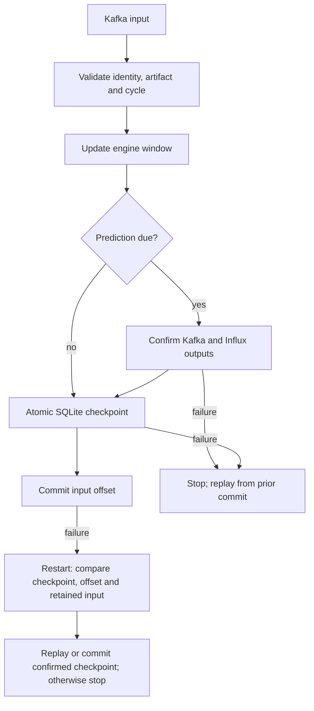
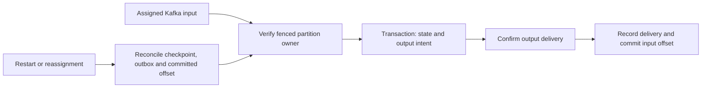

# Prediction window validation — work in progress

## Single-host deployment and lifecycle verification

**Decision: ACCEPTED FOR CONTROLLED SINGLE-HOST PREDICTION RECOVERY** under the topology and operational conditions below. This is not production deployment approval or acceptance of the broader pipeline. Cross-host failover, unrelated preprocessing reliability and initialization of an existing nonzero Kafka group without a matching checkpoint remain outside this acceptance.

The current Compose prediction service specifies `scale: 1`, a fixed container name, `PREDICTION_CHECKPOINT_PATH=/var/lib/pms-prediction/prediction.sqlite`, and the named volume `prediction-checkpoint` mounted at `/var/lib/pms-prediction`. The startup path now rejects a missing setting and rejects a directory that is not a dedicated, non-memory mount; `tmpfs`, `ramfs`, overlay and root filesystems are rejected. A named Docker volume is expected. This verifies mount type, not that the host storage is backed up, survives host failure or is not an ephemeral host bind mount. **Multi-host deployment and independent checkpoint volumes for the same group are prohibited**: the local lock is not distributed fencing.

For recreation, stop the existing prediction process, retain and back up the named volume and its SQLite and lock files, deploy only one validated image on the same host, remount the **same** volume at the same target, and retain the same checkpoint path, group, topics and validated model/scaler identities. Do not remove the volume or reset the Kafka group as part of recreation. Ensure the checkpoint input record remains in Kafka retention. On the first new input, the process reconciles its checkpoint against the committed offset and retained input hash; if they do not agree, it stops without committing. Existing groups with nonzero offsets but no matching checkpoint cannot be started safely by this mechanism and require a separately reviewed migration. No production operation is authorized by these instructions.

Isolated lifecycle evidence: Docker inspected the test checkpoint as named volume `pms-pred-checkpoint-test-v3` mounted read-write at `/state`, with an `ext4` mount. An idle process acquired its lock; a second process was rejected; normal stop exited 0 within a five-second stop window and another process acquired and read the checkpoint. An abrupt kill exited 137, after which another process acquired the lock and read cycle 31. A fresh container then restored the state, processed cycle 32 and advanced the group to offset 32 with three total predictions for cycles 30–32. The normal idle shutdown logged a Kafka `IllegalStateError` from the concurrently closed iterator despite exit 0; do not interpret the exit code as an error-free shutdown.

A temporary no-commit consumer joined the isolated single-partition group and triggered an actual Kafka revocation while cycle 31 was sent. The original process stopped; the group remained committed at 30 while the end was 31. A new process with the same volume restored state, produced the expected cycle-31 prediction and committed 31. This tested a group change with pending input, but did **not** deliberately suspend an in-flight output or prove multi-host fencing. Missing checkpoint configuration and container-only `/tmp` paths failed application startup; a separate mounted `tmpfs` was rejected. These are isolated tests, not production deployment evidence.

In a subsequent isolated run, a test-only hook delayed cycle 33 immediately before output publication while a second, no-commit test consumer joined the Kafka group. Kafka reported group rebalancing and partition revocation. The group finished at committed/end offset 33 with zero lag, the checkpoint recorded offset 32 and cycle 33, and Kafka and InfluxDB each contained four predictions for cycles 30–33. This is evidence for this timing and a single local owner, not a proof for every rebalance interleaving or cross-host fencing. The hook is retained in the investigation workspace as `prediction_slow_publish.py`.

The consumer now uses a bounded one-second iterator so an idle partition revocation can terminate the consumer loop and release its lock without a new record. In a further isolated broker-triggered idle rebalance, logs showed revocation at 09:53:27 UTC and group departure within the following second; a separate process acquired the checkpoint lock without publishing telemetry. A fresh consumer then restored the same checkpoint, processed cycle 34 and reached committed/end offset 34 with zero lag and five total Kafka predictions for cycles 30–34. The API process remains running but unready after its consumer stops and requires operator-managed restart. The exact one-second timing is an observation, not a hard scheduling guarantee.

After the final bounded-polling lifecycle change, focused prediction checks reported **17 passed, 218 warnings, 5 subtests passed**. The complete network-disabled tests directory reported **363 passed, 6 skipped, 230 warnings, 8 subtests passed**; four broker-dependent skipped tests were separately rerun against isolated services and **4 passed, 227 warnings** before that prediction-only polling change. The remaining two skips require `unrar`. Do not add the overlapping rerun or focused checks to the full-suite count. Native Windows prediction startup is not supported by the current mount guard; the tested deployment uses Linux containers. The final idle process exited 0 and a separate process reacquired the checkpoint at offset 33 / cycle 34.

The retained fault tests show an Influx outage can produce two Kafka records with the same deterministic prediction ID and one final Influx point; a client-injected commit exception after output and checkpoint recovered with one Kafka record and one point. Kafka is at-least-once, and callers must reconcile duplicates by `prediction_id`; do not claim exactly-once delivery. See `PIPELINE_E2E_VERIFICATION.md` for detailed offsets and counts.

## SQLite checkpoint implementation — verification in progress

This section supersedes the earlier statements below that no checkpoint implementation exists. The current implementation is deliberately limited to **one consumer instance, one Kafka input partition, and one local filesystem shared exclusively by processes that use the same checkpoint path**. It uses a nonblocking local file lock (POSIX or Windows) and SQLite transactions with `synchronous=FULL`; SQLite and a local file lock do not fence replicas on different hosts or independent volumes. Do not use this design for distributed ownership or multi-partition processing. An absolute `PREDICTION_CHECKPOINT_PATH` in an existing persistent mounted directory is mandatory. The container must preserve that volume on recreation. No production Compose change or deployment is implied.

Schema version 1 stores a single atomic JSON snapshot: group, input/output topic, partition and processed input offset; the input record's canonical SHA-256; the model checkpoint SHA-256; preprocessing artifact version and artifact hashes; and each dataset/unit/run key's last accepted cycle, latest metadata and up to 30 feature vectors. On startup the service checks schema, artifact identity and window structure. Before processing the first assigned record it checks that Kafka's committed position is either the snapshot offset or the next offset, verifies the checkpoint record is retained and still has the same hash, and fails closed on an unexpected offset, missing checkpoint or unsupported partition count. A checkpoint ahead by one input record represents completed output before an unconfirmed offset commit: when that exact record is redelivered, the service commits it without publishing the output again. It stops on partition revocation and relies on Kafka's group generation to reject stale commits.

The actual order is validate → update window → **confirm Kafka and InfluxDB outputs if a prediction is due** → atomically save checkpoint → commit input offset. Persisting only after both outputs are confirmed avoids treating an unpublished prediction as complete; it differs from a checkpoint-before-publication outbox. Before checkpoint persistence, a crash can replay the input. If Kafka output succeeded before InfluxDB or checkpoint failure, replay can publish a duplicate Kafka record. Each Kafka prediction carries a deterministic `prediction_id` and key derived from dataset, unit, run, cycle, model and preprocessing artifact version so duplicates can be identified; Kafka is not deduplicated automatically. InfluxDB uses its existing point identity and stable source timestamp. This is at-least-once behavior, not exactly-once. If commit succeeds but its response is lost, startup reconciles the broker's committed offset with the snapshot. If checkpoint or input history is missing, corrupt, inconsistent, truncated or incompatible, processing stops for operator investigation rather than silently skipping records. Reconciliation happens when the first new input is received; readiness remains false before then.

In a fresh real-service isolated test, 29 FD001 feature records were processed and committed at offset 29; the checkpoint held cycle 29 and 29 vectors. A new container using the same volume and group consumed cycle 30 at offset 29, verified retained history, emitted exactly one Kafka prediction (RUL `119.66515350341797`, `prediction_id` `42a66f5efc3576638f54c3cdd4eafcc8c218a7f1e711f6db7a4d1db7ca1413aa`), stored one matching Influx point, and committed offset 30 with zero lag. Source input topic `cp-recovery-input-v3`, output `cp-recovery-output-v3`, group `cp-recovery-group-v3`, and volume `pms-pred-checkpoint-test-v3` were isolated test resources.

Focused checks passed for multiple engines/runs, gap and duplicate cycles, artifact mismatch, invalid checkpoint schema/JSON, local lock contention, unavailable checkpoint history, a revocation callback, and mocked output and commit failures. A mocked double publication generated two records with the same deterministic identity. Subsequent real-service output and client-side commit fault checks, local assignment/revocation and idle lock release are recorded here. Cross-host fencing remains unsupported.

The checkpoint rewrites the bounded in-memory snapshot on every committed record; throughput and maximum-state disk usage have not been benchmarked. Artifact hashes in the snapshot bind the restored window to the local manifest and model, while each feature record supplies only a declared preprocessing version; that declaration is not an independently verified per-record scaler hash. The Windows file-lock branch has not been tested in this environment.

| Check | Expected | Observed and scope |
| --- | --- | --- |
| Restart after 29 | One prediction at cycle 30, commit 30 | One Kafka output and one Influx point; commit 30, real isolated Kafka and fresh container. |
| Output failure | No commit past cycle 30; retry generates output | Mocked failure retained commit 29; retry committed 30 with one captured output. |
| Commit failure after output and checkpoint | Replay commits without a missing or second publication | Mocked failure retained commit 29; replay committed 30 with one captured output. A crash before checkpoint can still duplicate output. |
| Multiple engines and runs | Separate 30-cycle windows | Three separately restored mocked windows each predicted from cycles 1–30. |
| Duplicate, gap, new run | No invalid window prediction | Focused unit tests passed; no real-broker sequence-failure test in this round. |
| Corrupt checkpoint / incompatible artifacts | Fail closed | Invalid JSON, schema and model hash unit checks passed. |
| Missing checkpoint history | Fail closed | A mocked Kafka reader with earliest offset beyond the checkpoint was rejected; no real retention/deletion test was performed. |
| Revocation and reassignment | Stop old owner and safely restore new owner | Revocation callback unit check and ordinary fresh-container restart passed; an actual broker-triggered reassignment during processing remains unverified. |

### Subsequent real-service fault checks

All tests below used the existing isolated `pms-final-e2e-20261120_isolated` network, unique input topics, consumer groups and checkpoint volumes; no production endpoints were used.

* **Output failure:** for run `pf-output-failure-run`, cycles 1–29 committed at offset 29. The isolated InfluxDB was disconnected, then cycle 30 at input offset 29 was sent. Kafka received one prediction but the Influx write failed; the group remained at 29 with lag 1. After reconnecting InfluxDB and starting a fresh process with the same volume, the group committed 30 with zero lag. Kafka contained two identical prediction records, both ID `c27352d4b2d0856fe1fa8ae1db69e65c06cb0bc9bd33214cbc0b887a4a37c4d4`; InfluxDB contained one point with RUL `119.66515350341797`. This confirms at-least-once duplicate delivery at this boundary.
* **Commit failure:** for `pf-commit-failure-run`, a test-only hook raised immediately before committing input offset 30, after real Kafka and Influx output and SQLite checkpoint completion. The broker remained at commit 29, the checkpoint was at input offset 29, and one Kafka output and one Influx point existed. A fresh process reconciled the checkpoint, committed 30 and did not republish that prediction. ID was `93228b757a7b2444fda3ea9ae8a9ee1b28424a31b5c1d64a2886798eb25dbad6`. After cycle 31, commit and input end both reached 31, Kafka had two predictions and InfluxDB two points. The injected commit exception was client-side, not a broker-induced commit error.
* **Ownership and assignment:** a concurrent isolated process mounting the same checkpoint volume failed with `prediction checkpoint is already owned` and did not join the group. The fresh process above received a new consumer identity, restored the checkpoint, and processed cycle 31. A separate two-partition input test stopped with `checkpoint mode requires exactly one assigned topic partition` on its first message and made no group commit. These checks do not test a broker-triggered rebalance while an output is in flight or multiple hosts with independent volumes.

The service requires a dedicated non-memory mount and documents a persistent volume as an operational requirement; it does not independently prove that the underlying host storage is durable or that another host cannot use a different path. Those deployment constraints require operator verification. The readiness signal remains false until the first record is reconciled. These limits preclude distributed failover claims.

Earlier regression: the network-disabled suite reported **361 passed, 6 skipped, 230 warnings and 8 subtests passed**; the later final suite is recorded above.

The broader network-disabled `tests` run reported **361 passed, 6 skipped, 230 warnings and 8 subtests passed**. The skips were two `unrar` checks and four broker-dependent tests. That run began before the final Windows-lock portability and cleanup-finally edits; after those edits, the focused prediction suite reported **15 passed, 218 warnings and 5 subtests passed**. The Windows lock implementation itself was not exercised. Do not add the overlapping focused checks to the broader count.

## Historical findings before checkpoint implementation

The following paragraphs record the earlier implementation and are superseded by the SQLite section above. At that time, streaming prediction rejected unsupported datasets and invalid cycles, kept separate windows by dataset, unit and run, ignored duplicate or backward cycles, and cleared a window when a forward gap was observed. A gap started a fresh warm-up at the incoming cycle. Prediction resumed only after 30 consecutive accepted records in that new window. After restart, windows were empty and had to warm up again.

The request endpoint checks its last 30 records for positive consecutive integer cycles and rejects explicit identity mismatches. It predicts from those records without mutating the streaming window. The endpoint's optional per-row identity fields can be absent, so the request-level identity is an assertion by the caller, not independently verified provenance.

Focused isolated unit checks verified exact cycles 1–30, a gap and 30-cycle re-warm, duplicates, out-of-order records, separate unit/run keys and invalid cycles. Production use still requires integration, restart and failure verification, and an explicit policy for missing historical predictions.

An isolated two-process probe with a test inference engine accepted cycles 1–29 in one process (window length 29, no predictions), then cycle 30 in a fresh process (window length 1, no predictions). This confirms state is not restored across that process boundary; it is not a Kafka or real-model restart test. No process-restart test after cycle 15 or after a first prediction has established restoration. A fresh warm-up is the current behavior, and continuity of all expected predictions across restart is unproven. The probe is retained as `prediction_restart_probe.py` in the assessment workspace.

The later real Kafka and model-service restart test in `PIPELINE_E2E_VERIFICATION.md` confirmed the same defect: input cycles 1–29 were committed, the isolated service restarted, and cycle 30 was committed without a prediction. No state-persistence fix has been implemented.

## Candidate recovery design — not implemented

Kafka retention cannot be assumed to contain enough history, as the production topics previously had none. A local SQLite or container-volume checkpoint is insufficient for reassignment to another host or container. InfluxDB points do not retain every feature vector and input offset needed to recreate a prediction window. PostgreSQL is already part of the infrastructure and is a candidate for a shared transactional checkpoint and outbox, subject to an approved schema and operational review; no production database changes have been made.

One design to validate is a PostgreSQL transaction per ordered input record that verifies a fenced partition ownership epoch, persists the source topic/partition/offset and each affected dataset/unit/run's last cycle plus at least 29 consecutive feature vectors, and writes a deterministic output to an outbox when a prediction is due. Publish the outbox with confirmed Kafka delivery and idempotent output identity, mark it delivered, then commit only the corresponding Kafka input offset. On reassignment, acquire a higher fencing epoch and reconcile the committed Kafka position, durable checkpoint, and pending outbox before polling new input. If a checkpoint is ahead of the Kafka commit, replay must recognize the source identity and finish or verify its outbox instead of applying the record again. A crash after Kafka output but before its durable delivery mark can still duplicate output; consumers and Influx identity must tolerate and reconcile that case. Ownership checks cannot make Kafka and PostgreSQL one atomic transaction; stale publication and external side effects need explicit fencing/idempotency and real rebalance tests.

This is a proposed architecture, not a proven guarantee. It needs a versioned schema, durable shared database, source-key/partition affinity, lease and stale-owner handling, transactional failure policy, backup and restore, bounded state retention, and tests for each crash boundary. Production recovery remains blocked until an implementation and independent integration evidence exist.

## Prediction recovery task status

**NOT ACCEPTED:** durable checkpointing or Kafka-history reconstruction has not been implemented. A fresh process still loses its windows, and no new real-Kafka restart, failed-output, commit-failure or duplicate-reconciliation acceptance run was completed for this task. The previously observed real-service result remains: cycles 1–29 were committed, cycle 30 was committed after restart, and the expected prediction was missing.

As a partial safeguard, a prediction service that has validated its model and preprocessing manifest now rejects input whose `preprocessing_artifact_version` is missing or differs from the validated manifest. The manifest's artifact version is included in the compatibility report. The consumer's existing failure path stops instead of committing such an input. The guard checks the declared version, not a cryptographic identity carried on every input record, and does not establish the model version used before a restart. When startup artifact validation is explicitly disabled, this guard is disabled as well; do not use that mode as evidence of production compatibility.

Focused network-disabled tests of prediction and artifact compatibility reported 8 passed, with 5 unittest subtests passed and 218 dependency deprecation warnings. These are unit tests, not recovery acceptance or real-service evidence. The earlier retained-topic experiment established that fail-stop redelivery is possible but did not solve state restoration, multi-owner reassignment or duplicate publication after a successful output and failed commit.
# Consolidated release candidate review — 20 November 2026

In the fresh isolated 40-cycle MQTT run, prediction restarted during the replay using its persistent checkpoint and emitted 11 unique prediction IDs for cycles 30–40. Its consumer committed 40/40 after processing offset 39. The end-to-end evidence does not expand the supported single-instance, single-partition, single-host topology or make Kafka and InfluxDB writes atomic. See `RELIABILITY_RELEASE_CANDIDATE.md`.
