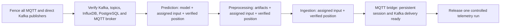

# Production pipeline forward-recovery readiness

Assessment: 20 November 2026. **Decision: NOT READY.** This is a preparation document, not permission to restart or deploy. The required integrated dry run has not been completed, downstream failure handling has unresolved data-loss risks, and a verified rollback artifact for the stopped ingestion image has not been located. No starting offset should be chosen solely from this snapshot.

Remediation update: the working tree now contains fail-stop, per-partition commit changes and prediction cycle-gap validation. Focused mocked checks passed, but real-broker failure/rebalance and state-reconstruction tests, the full isolated MQTT-to-prediction dry run, the fresh combined suite and a verified rollback artifact are still outstanding. The code-path discussion below describes the assessed baseline before these uncommitted changes; see `PIPELINE_OFFSET_SAFETY.md`, `PREDICTION_WINDOW_VALIDATION.md`, and `PIPELINE_E2E_VERIFICATION.md` for the current status. Decision remains **NOT READY**.

Subsequent update: 349 tests passed and 6 were skipped in a fresh isolated pytest runtime, and a real two-partition test confirmed fail-stop replay while also confirming that independent partition progress is not implemented. A reconstructed ingestion image passed only a smoke check and is not a verified rollback artifact. Durable state recovery, the integrated MQTT-to-prediction run, rebalances and the full failure matrix remain outstanding. The later evidence supersedes the statement above that no fresh suite was run; the decision remains **NOT READY**.

Latest update: an image containing the exact accepted Module 02 ingestion source passed 130 frozen consumer/bridge tests in isolation. It is distinct from the unavailable original image and has not passed a fresh end-to-end rollback test. Partition isolation and durable prediction state are still design proposals, not implemented. Decision remains **NOT READY**.

The later isolated 40-cycle MQTT-to-prediction happy path produced 40 sensor points, 40 features and 11 predictions. A real prediction-service restart after cycle 29 then committed cycle 30 without a prediction. The checkout's mounted scaler statistics also failed artifact hash validation, although packaged test-image artifacts passed. See `PIPELINE_E2E_VERIFICATION.md` for scope and evidence. These results do not satisfy partition isolation or durable restart recovery; decision remains **NOT READY**.

Artifact investigation update: checkout and packaged statistics JSON differed only by LF/CRLF; the validator now accepts only an exact hash or a line-ending-only equivalent. The checkout checkpoint and scalers match packaged bytes, and representative per-dataset preprocessing output matched. The scikit-learn version warning remains and broad compatibility has not been proven. Prediction persistence, partition isolation and their failure/rebalance acceptance tests remain unimplemented; the decision remains **NOT READY**.

Prediction-specific update: Compose now defines one prediction instance and a dedicated named checkpoint volume, with startup rejection for a missing or non-mounted checkpoint directory. Isolated normal and abrupt lock-release and a broker-triggered group change with pending input were tested; see `PREDICTION_WINDOW_VALIDATION.md`. Multi-host use is prohibited. A separately reviewed initialization/migration remains necessary for production's nonzero offsets and absent checkpoint; preprocessing partition isolation and broader production recovery remain outstanding. These changes do not authorize a production restart.

An isolated test also delayed a prediction output while a second test consumer triggered a group change; the input, checkpoint, Kafka and InfluxDB counts reconciled for that run. This does not authorize multi-host operation or resolve the production offset/checkpoint migration.

After the later isolated integration run, sampled production container states matched the starting observation, Kafka earliest/latest bounds remained 20,671/20,671 for sensor and preprocessing, 17,742/17,742 for predictions and 0/0 for dead-letter, and PostgreSQL table counts matched the pre-test counts. Production InfluxDB contents were not freshly compared in this round. These are sampled checks, not a byte-for-byte environment comparison. Test services were stopped and their volumes retained.

## Current state and evidence

Git is `main` at `59d37fbcf3175e248bd6ea1ac8d9b4af582dc11c`, one commit ahead of `origin/main`; existing modified `.gitignore` and `simulator/src/ims_loader.py` and untracked Module 01 verification, recovery assessment and crest-factor test files were preserved. Module 01 documentation names `256faefd914aadef7dd6e07077287a8ffd3cb06c`; Module 02 accepted source is `af65ac69e273e84eabe0dc1de964dd17b7b4ea71`, with documentation freeze at current HEAD. The modified simulator source is not part of either frozen commit.

Read-only inspection found Kafka, ZooKeeper, InfluxDB and PostgreSQL running; consumer, preprocessing, prediction, backend and simulator stopped. No production Mosquitto or MQTT bridge container was listed. PostgreSQL exact counts: users 3, audit_logs 48, alerts 14, alert_audit 24, anomaly_records 20, email_verification_tokens 6, password_reset_tokens 0, revoked_tokens 3. The latest prior InfluxDB reconciliation found `sensor_telemetry` 41,302 points and `rul_predictions` 17,742 points; **a fresh InfluxDB count was not performed in this assessment**, so those counts are historical, not proof of current equality. The separate recovery assessment describes coverage and unit tag differences.

Production named volumes observed: `predictive-maintenance-system_kafka-data`, `predictive-maintenance-system_zookeeper-data`, `predictive-maintenance-system_zookeeper-log`, `predictive-maintenance-system_influxdb-data`, and `predictive-maintenance-system_postgres-data`. No volumes were deleted. Compose uses a single Kafka broker and replication factor 1, creates topics automatically, starts the ingestion consumer and bridge with `restart: on-failure`, and does not enforce downstream assignments before a publisher starts. Its simulator defaults to `PUBLISH_TRANSPORT=kafka`; selecting MQTT explicitly is necessary for an MQTT-path acceptance run. Mosquitto is configured for persistence and anonymous connections; approve its production security and persistent volume/session configuration separately.

## Images and source audit

| Service | Stopped container image ID, abbreviated | Evidence and proposed action |
| --- | --- | --- |
| ingestion consumer | `a72ce62ebac4` | Its `/app/src/kafka_consumer.py` Git blob `37bbd03230c96799274e6ef9995d5f1812da3ea0` matches the file at commit `ac01f6180c19763f92d59a932210d99c777b9cf5`; this identifies that file, not necessarily the entire image revision. It differs from accepted blob `975ffeb07b924756b6aa9ce77cd2e64255ff11c8`. The stopped container has no `/app/src/mqtt_bridge.py`. `docker run` by its image ID reported no such image; the local `predictive-maintenance-system-consumer:latest` resolves instead to `0c4bbd50aefa`. Preserve the container and locate or reconstruct and verify an actual rollback image before replacement. |
| preprocessing | `dad90cc30c24` | Deployed `ml/streaming/preprocessing.py` blob matches the checkout; the entire image revision and all dependencies are not proven by one matching file. Current code has the failure risks below. |
| prediction | `bee9fb01657d` | Deployed `ml/prediction/service.py` blob matches the checkout; full image provenance remains unverified. The local `prediction:latest` is a different ID, `d892b3a51441`. |
| simulator | `136acc632dec` | Full source revision unverified; local `simulator:latest` is a different ID, `ee2f67c8ba47`. Select a verified Module 01 image and an explicitly approved transport; do not silently include the dirty simulator change. |
| MQTT bridge | no production container observed | Build and verify the accepted Module 02 bridge if MQTT is selected. |
| backend | `fd8362046540` | Stopped; not a required telemetry-processing dependency, but downstream API/alert requirements must be explicitly assessed before exposing them. |

The old deployed ingestion file uses manual Kafka commits, synchronous Influx writes with retry, and confirmed DLQ sends. It lacks accepted validations for finite numbers, schema/version envelope and other field constraints, and differs in error classification. The frozen bridge uses stable client identity, MQTT QoS 1 persistent session (`clean_session=False`), `manual_ack=True`, explicit acknowledgment, and `producer.send(...).get(timeout=10)` before acknowledging confirmed Kafka or dead-letter delivery. The broker must retain the session and QoS 1 message; these properties do not imply exactly-once processing. See the Module 02 verification documentation for actual failure-test limits.

From the stopped ingestion container's installed metadata: kafka-python 2.3.2, influxdb-client 1.50.0 and python-dotenv 1.2.2; no Paho metadata was found. Accepted requirements are ranges, not locks: kafka-python >=2.0.2, influxdb-client >=1.38.0, python-dotenv >=1.0.0, paho-mqtt >=2.0,<3. The Module 02 isolated verification observed kafka-python 3.0.13 and Paho 2.2.0; actual versions of a new build are unverified. Non-secret deployed environment entries inspected for Kafka broker, topic, Influx URL, polling, timeout and commit settings match the corresponding checkout Compose entries; defaulted variables, all other environment differences, secrets and image-wide dependencies were not exhaustively compared.

### Proposed reproducible build, not executed

Export the tracked ingestion subtree from exactly `af65ac69e273e84eabe0dc1de964dd17b7b4ea71` into a clean isolated build context; verify the commit and file hashes and exclude working-tree changes. Build an image using `ingestion/Dockerfile`, provisionally tagged `pms-ingestion:module2-af65ac69`, with a source-revision label; use that same tested digest for consumer and bridge. The current Dockerfile references mutable `python:3.11-slim` and unpinned dependency ranges, so a commit and tag alone are **not reproducible**. Resolve and review a base-image digest and complete locked dependencies, record Python and package versions plus artifact digest, and rerun the Module 02 regression and real-service recovery checks on that exact digest. Pin and independently verify preprocessing, prediction, model, scaler, simulator and broker artifacts too. No production build, tag replacement or deployment is authorized here.

## Consumer groups and initial positions

On this assessment the Kafka group list was empty. Topic partition 0 bounds, written as `[earliest, latest)`, were `sensor-telemetry [20671,20671)`, `preprocessed-telemetry [20671,20671)`, `rul-predictions [17742,17742)`, and `sensor-telemetry-dead-letter [0,0)`. These are moving observations. The preceding investigation documented that the three groups expired; the normal group API no longer provides their commits. Historical commits were 20,671, not recoverable history.

| Group | Topic; reset | Current commit | Forward-only position recommendation |
| --- | --- | --- | --- |
| `influxdb-writer-group` | sensor; `earliest` | absent | With every source fenced and no pending broker messages, independently check and record each partition's end immediately before startup; that end is the proposed start boundary, subject to operator approval. At the observed empty boundary, `earliest` also resolves to 20,671. If records have arrived or earliest differs from latest, stop and decide whether they must be processed; do not silently discard or replay. |
| `preprocessing-service-group` | sensor; `latest` | absent | Same source fence and agreed sensor boundary. Assignment and initialized position must be confirmed before the bridge or any direct producer is allowed to publish. If telemetry arrives first, `latest` may skip it. |
| `rul-prediction-service-group` | preprocessed; `latest` | absent | Fence preprocessing output, verify the preprocessed end and establish assignment/position before starting preprocessing. `latest` can skip features produced before assignment. |

With no committed offset, `earliest` uses the current retained beginning and can replay retained history; `latest` starts at the current end and can skip earlier arrivals. The agreed partition boundaries must be rechecked and recorded, not hard-coded as `20671`. No group was created or offset set in this assessment. Establishing explicit positions or changing reset behavior requires a separately approved operational action and tested tooling; if an old commit unexpectedly reappears, stop and investigate. Never apply an automatic reset to resolve an ambiguity.

## Proposed startup dependencies

The suggested downstream-first order is appropriate only with all actual publishers fenced, including independent MQTT clients and the simulator's direct Kafka mode. A persistent MQTT session can deliver queued messages as soon as the bridge connects, so connecting the bridge is itself a potential publication step: first assess the broker's existing session and queue, approve a policy for pending data, and ensure both sensor consumers are ready. `depends_on` and a process being alive do not prove assignment. Prediction `/ready` initializes its consumer flag before assignment and explicitly does not verify Influx write permission; it is insufficient on its own. Verify Kafka group membership, every expected partition assignment and initialized position against the agreed boundary, source fencing, model/scaler load and database permissions through approved non-production-write methods. No canary should enter production until the explicit controlled-run approval.

## Stateful processing and critical risks

Preprocessing lazily loads dataset scaler and training statistics; it keeps up to 1,024 dataset/unit/run states, filling missing values from the prior value or training median, clipping outliers and applying the scaler. It retains up to 30 transformed rows but emits the current transformed feature vector from the first accepted record; prior in-memory state is not restored on restart. Unit/run keys must remain stable. Output omits original event ID and sequence, limiting reconciliation.

Prediction loads its model, keeps per-key in-memory deques of 30 feature vectors (bounded to 1,024 keys), emits no RUL for the first 29 accepted records, then may predict on record 30 and later. State is lost on restart or eviction. Its code rejects duplicate/backward cycles but does **not** check for gaps, so 30 accepted rows are not necessarily 30 consecutive cycles. The forward plan must independently check ordered cycles, schema, unit/run identity and all 30 actual vectors against the model input. Do not manufacture historical predictions. Require the isolated run to observe no output through cycle 29, one correctly attributed prediction at 30, and then expected incremental outputs; separately test gaps, duplicates, restart and eviction.

**Blocking code risks, based on source inspection:** preprocessing mutates its in-memory state before Kafka output is confirmed. On an output exception its loop logs that the offset was not committed but continues to later records, and a later `consumer.commit()` can advance beyond the failed record. Prediction similarly mutates its window/last-cycle before publishing; it publishes Kafka first, then writes InfluxDB, and on an exception continues. A later commit can cover the failed record; partial Kafka success can also produce duplicates on retry. Both services commit certain invalid records without a DLQ. Thus failure logs or a nominal manual-commit setting do not guarantee no lost outputs. These are reasoned code-path findings, not a claim that a new fault-injection experiment was run in this assessment. Remediate or adopt a separately reviewed equivalent control and prove it with real failure/recovery tests before production recovery.

## Monitoring and stage gates

Before release: verified image digests and artifacts; infrastructure health and capacity; all publishers fenced; empty or reconciled queues; expected partitions assigned; positions checked; no unexplained lag; model/scaler initialized; supported datasets and credentials verified; approved baseline backup and recovery operator. A running service is not sufficient.

For the controlled run, record run ID, expected events per unit and cycles, source timestamps, sensor values and event IDs. Monitor MQTT connection, session/redeliveries, confirmed delivery and acknowledgment failures; Kafka partition bounds, positions, group assignments, lag, processing errors and DLQ deltas; Influx point identity, timestamp, tags and sensor values; preprocessing input/output and invalid counts; prediction window length, actual ordered cycles, output count, RUL values and model errors. Influx point identity is measurement plus tags and timestamp, not `event_id`; the existing prediction/telemetry unit string mismatch must be reconciled without changing historical tags. Expected duplicates, invalids and side effects need explicit thresholds; any unexpected delta or assignment change stops admission of new source events pending investigation.

For an isolated 40-cycle, one-unit run with valid contiguous input and no retries, the prospective acceptance target is 40 source events, 40 sensor topic records, 40 persisted sensor points, 40 valid feature outputs, no prediction through cycle 29 and 11 predictions for cycles 30–40, with corresponding committed positions and zero unexpected DLQ records. Reconcile actual identities and values rather than counts alone. Production acceptance thresholds and allowed duplicate semantics require operator approval.

## Isolated dry-run status

**Not completed in this assessment.** The existing M6 test volume contains 40 sensor, 40 preprocessing and 11 prediction test records from an earlier isolated run; it does not prove a new MQTT-to-Influx-to-prediction run or the proposed assignment gates. Previous Module 02 MQTT-to-Influx verification did not include the entire prediction path. The repository's M6 Compose file has fixed names and reuses an existing M6 test volume, lacks Mosquitto/bridge, and therefore must not be run unchanged as the new isolated test. The exact stopped ingestion image ID is not available locally, so an identical-image rollback/reproduction is also not currently possible. A fresh unique Compose project with separate network, Kafka, Mosquitto, InfluxDB, volumes, test groups and no production endpoints, plus an independently verified candidate image, is still technically feasible but has not been prepared or executed; this is an outstanding acceptance task, not evidence of success.

The new dry run must validate infrastructure isolation before starting, then execute the dependency gates and 40-cycle reconciliation above, record all group positions and run IDs, inject producer, database and commit failures, verify no skipped outputs, and retain evidence and volumes without touching production. Test broker queue/session behavior and database outages. No production service should be connected to this test.

## Rollback and operator decisions

If an approved future cutover fails, first stop admission at **all** sources, including direct Kafka and external MQTT publishers; do not assume stopping the simulator fences external sources. Prevent uncontrolled restarts, preserve all Kafka topics, committed offsets, database records, logs and volumes, and record current assignments, positions and partial outputs. Pause the affected consumers under the approved runbook; do not reset offsets automatically. Assess Kafka/Influx partial writes, duplicate point identities, predictions and downstream side effects. Never overwrite production with an old database backup. Restore a previously tested, digest-pinned service image only after checking compatibility; the deployed ingestion image is not presently available by ID and must be recovered or replaced with a verified equivalent before claiming rollback readiness. Image rollback alone cannot undo writes or reconstruct in-memory state. Define a fresh, operator-approved per-partition resume position and warm-up after reconciliation.

Specific failure gates: ingestion or Influx failure requires preserving uncommitted input and reconciling point identities; bridge failure requires preserving its MQTT session and unacknowledged messages; preprocessing failure requires auditing input/output gaps and state; prediction failure requires reconciling Kafka and Influx separately and warming a clean, consecutive 30-cycle window; assignment failure or unexpected backlog blocks publisher release; invalid predictions require stopping admission and downstream effects while retaining evidence. Rollback execution, image replacement, production group creation/offset selection, publisher release, database writes, and any deployment or configuration change each require explicit operator approval.

Outstanding decisions: source and artifact digests; dependency locks and package compatibility; durable source fencing and MQTT pending-session policy; exact just-in-time partition positions; remediation of downstream exception/commit behavior and invalid-record handling; 30-cycle continuity strategy; whether alert/backend side effects are in scope; a recoverable rollback artifact; full isolated dry run and reviewed acceptance thresholds. Until resolved, production recovery is not ready.
# Preprocessing isolation follow-up: 20 November 2026

Isolated broker tests demonstrate partition-specific progress, retry and reassignment for the tested scenarios; they do not by themselves authorize production recovery. The streaming image pins `kafka-python` 3.0.13 after follow-on fetching stalled during tests with 3.0.12. A commit outage can publish repeated features with the same input-derived Kafka key: an isolated failure produced 16 deliveries for one key. Downstream reconciliation or deduplication is necessary where repeated processing has effects. Revocation discards in-memory preprocessing state; restoration of prior imputation history is not implemented. Stale-owner commit fencing was not independently tested.

The consumer now resets missing or expired offsets to `earliest` to retain a first failed uncommitted input. An operator must assess retained history and establish approved offsets before starting a missing or expired group; otherwise historical replay can occur. No production services, offsets or databases were changed during these tests.
# Follow-up: preprocessing remains blocked, 20 November 2026

Confirmed output is no longer resent on each same-owner commit retry, but output ambiguity, crash and reassignment can still create duplicate records, and the prediction consumer does not deduplicate using the preprocessing Kafka key. A real isolated stale-member probe was fenced by Kafka; full worker and feature reconciliation for that scenario remains unverified. Forward-fill state is still lost at restart or reassignment, with measured feature differences in FD001–FD004 samples. Production forward recovery must not proceed on the assumption that preprocessing state is durable. The `earliest` reset and partition-affinity cautions below remain applicable.
# Preprocessing checkpoint readiness — 20 November 2026

The preprocessing worker now requires a checkpoint path and fails closed for missing or inconsistent historical state. The production Compose configuration has not been provided a shared persistent checkpoint volume and no production migration or bootstrap has been performed. The supported design is one host, one common persistent local SQLite file for all group members, and stable source partition affinity. Cross-host deployment and separate per-container checkpoint files are unsupported. A stale-owner checkpoint write after reassignment and reassignment during recovery remain unverified with real workers. Production recovery is not authorized by the isolated results.
# Controlled single-host checkpoint verification — 20 November 2026

Isolated tests now demonstrate rejection of a revoked preprocessing worker's checkpoint write after another actual worker acquires ownership, plus safe lock handoff and offset reconciliation when Kafka reassigns a partition during checkpoint restoration. These results cover the controlled single-host shared-local-checkpoint topology only. They do not configure a production volume, establish a bootstrap for existing consumer offsets, or authorize production deployment. The recovery and duplicate-delivery limitations described in `PIPELINE_OFFSET_SAFETY.md` still apply.
# Consolidated release candidate review — 20 November 2026

**Not ready for release:** checked-in Compose does not configure the required preprocessing checkpoint path or persistent volume, and the preprocessing path check alone cannot enforce the supported shared single-host storage topology. A fresh isolated end-to-end replay passed using explicit isolated volumes; that override does not prove the checked-in deployment works. Read-only production checks still found no Kafka consumer groups and no retained application records between earliest and latest offsets. See `RELIABILITY_RELEASE_CANDIDATE.md` for current counts, prerequisites and rollback constraints. No production recovery was performed.
# Preprocessing checkpoint deployment follow-up — 20 November 2026

The prior missing-Compose-volume blocker has been addressed in the checked-in configuration: preprocessing uses `/var/lib/pms-preprocessing/preprocessing.sqlite` on a dedicated named volume, with one Compose replica and startup validation of a writable dedicated local non-memory mount. A separate isolated Compose project verified recreation and state restoration; production was not recreated or deployed. Operators must still ensure one-host topology, shared local storage for any same-host owners, durable volume backups and a reviewed bootstrap for existing offsets. This is release-review readiness, not approval to restart production or choose offsets. See `RELIABILITY_RELEASE_CANDIDATE.md`.
