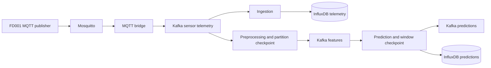

# Reliability release candidate review — 20 November 2026

**Decision: READY FOR RELEASE REVIEW.** Compose now mounts the dedicated `preprocessing-checkpoint` named volume at `/var/lib/pms-preprocessing`, with checkpoint path `/var/lib/pms-preprocessing/preprocessing.sqlite`. Startup rejects missing, container-layer, memory-backed, read-only and known network filesystem locations. An isolated Compose recreation preserved state and reproduced the uninterrupted FD001 feature. The mount check cannot prove physical durability or cross-host exclusivity: one host and one shared local checkpoint remain operational requirements. No production deployment is authorized by this review.

## Scope and inventory

Release staging review: the separately scoped IMS crest-factor edit and its three-case regression remain unstaged. The 367-pass working-tree result below included those cases. A subsequent network-isolated full run restored the HEAD version of `ims_loader.py` inside the test container and excluded that IMS regression: **364 passed, 0 failed, 6 skipped, 235 warnings and 5 passed subtests**. The independently rerun broker tests remain separate from both totals.

The frozen Module 02 ingestion commit is `af65ac69e273e84eabe0dc1de964dd17b7b4ea71`; no ingestion source diff was found against it. Local `main` is at `59d37fbcf3175e248bd6ea1ac8d9b4af582dc11c`, one baseline-documentation commit ahead of the locally recorded `origin/main`. The working tree also contains uncommitted prediction and preprocessing checkpointing, partition isolation, artifact compatibility checks, tests and documents. Streaming pins `kafka-python==3.0.13`. Compose now assigns each stateful service a dedicated checkpoint volume and one replica. The IMS crest-factor correction and historical data recovery and Module 01 verification documents are separate pre-existing work and need explicit release-scope review. All changes remain uncommitted.

## Fresh isolated evidence

Checkpoint deployment follow-up: a fresh isolated Compose project mounted its own local Docker named volume at `/var/lib/pms-preprocessing`. Mount metadata reported read/write, filesystem `ext4`, and the image's service user was able to write. A second process could not acquire the active partition lock. The preprocessing container was force-recreated with a different container ID; checkpoint and Kafka positions advanced from 1/1 to 2/2, two inputs produced two unique output keys, and the missing-sensor second FD001 feature matched uninterrupted preprocessing with maximum absolute difference 0.0. Missing paths, container-layer paths, tmpfs and read-only mounts were rejected. This test did not mount production storage. The final focused suite reported 44 passed, 0 failed, 0 skipped, 235 warnings and 5 passed subtests; the full suite reported 367 passed, 0 failed, 6 skipped, 235 warnings and 5 passed subtests. Separate historical broker reruns below are not included in those totals.

A new internal-only Compose project, separate topics and volumes, frozen ingestion image and current ML source processed run `rc-review-20261120-fd001` exclusively via MQTT. Both stateful workers were restarted during the 40-cycle replay. Kafka held 40 distinct input event IDs, 40 features with unique source-derived keys matching input offsets, and 11 predictions with unique IDs matching their Kafka keys for cycles 30–40. InfluxDB contained 40 telemetry and 11 prediction points for the run. The ingestion and preprocessing groups committed 40/40 on `sensor-telemetry`; prediction committed 40/40 on `preprocessed-telemetry`. Preprocessing checkpoint next offset was 40; prediction checkpoint recorded offset 39. Original input event IDs are not propagated in the feature payload, so reconciliation relies on source-derived Kafka keys and run/cycle identity.

On a separate fresh two-partition test topic, injected output failure held partition 0 uncommitted while partition 1 reached 1/1. After output recovery, a commit fault left partition 0 uncommitted with checkpoint next offset 1; clearing it advanced both partitions to 1/1. A subsequent rebalance transferred partition 0 at offset 1 to another worker; the old owner's deliberate stale checkpoint write was rejected, the new owner's checkpoint was unchanged, and the partition advanced to 2/2. Three input identities yielded three output keys. Prior isolated crash and prediction failure evidence remains in the linked component documents; these particular failure injections were client-side, not independent broker outages. Duplicate delivery remains possible at crash and ambiguous-output boundaries.

The final full suite, run network-isolated, reported **366 passed, 0 failed, 6 skipped, 235 warnings and 5 passed subtests**. Two skips require `unrar`; four require the broker. Those four broker-dependent Module 01 tests were separately rerun against the fresh isolated Kafka and MQTT services: **4 passed, 0 failed, 0 skipped, 227 warnings**. Focused checkpoint, preprocessing, prediction, artifact and IMS tests: **48 passed, 0 failed, 0 skipped, 235 warnings and 5 passed subtests**. Do not add separate test counts to the full-suite total.

## Read-only production comparison

Production Kafka, ZooKeeper, InfluxDB and PostgreSQL were running; the ingestion, preprocessing and prediction containers were stopped. Kafka listed no consumer groups. Earliest and latest offsets were both 20,671 for sensor and preprocessed telemetry, 17,742 for predictions, and 0 for the dead-letter topic, matching the previous expiration investigation. The three historical committed group offsets are unavailable; do not select a restart position from this observation. InfluxDB returned 41,302 telemetry `time_cycles` values and 17,742 prediction `rul` values, matching the prior assessment. Exact PostgreSQL counts for alert_audit, alerts, anomaly_records, audit_logs, email_verification_tokens, password_reset_tokens, revoked_tokens and users were 24, 14, 20, 48, 6, 0, 3 and 3, matching the remediation baseline. These are sampled read-only checks, not a full database content comparison.

## Prerequisites and rollback

The supported stateful topology is one host with persistent checkpoint volumes and a single shared local preprocessing checkpoint file across group members; Kafka key affinity must keep each engine/run on one partition. Prediction supports one instance and one input partition. Checkpoint data, Kafka positions and artifacts must be reconciled and backed up together; existing nonzero groups cannot be silently bootstrapped into empty state. SQLite and Kafka writes are not transactional, and duplicate features and predictions can occur. Downstream side effects need reconciliation. Prediction's InfluxDB point identity and Kafka ID do not make all downstream actions exactly-once. IMS-to-InfluxDB ingestion remains outside the frozen Module 02 scope.

Before any separately approved production action, decide publisher fencing and MQTT pending-session policy, source/topic retention, checkpoint initialization, approved starting positions, artifact and image identities, deployment sequencing, monitoring and rollback. Preserve offsets, checkpoints and databases during rollback; replacing an image cannot undo writes or reconstruct missing history. The previously documented historical Kafka records and offsets have not been recovered.
